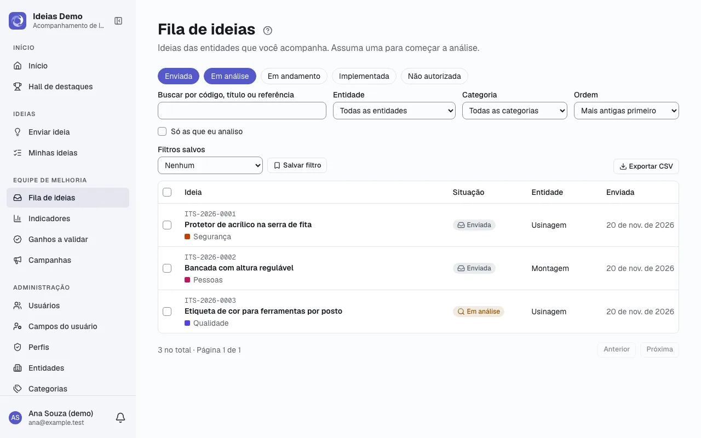

# ITS – Idea Tracking System

[](https://github.com/IvanBelshoff/idea-tracking-system/releases)
[](https://github.com/IvanBelshoff/idea-tracking-system/actions/workflows/ci.yml)
[](https://hub.docker.com/r/ivanbelshoff/its-api)
[](https://ivanbelshoff.github.io/idea-tracking-system/)
[](LICENSE)

**Sistema de Acompanhamento de Ideias**, aberto e gratuito, para qualquer organização. Colaboradores enviam ideias, a equipe faz a triagem e conduz a execução em etapas com prazo, quem enviou acompanha cada passo e as melhores ideias são reconhecidas. Uma instalação atende uma organização inteira, com as suas unidades e áreas, como o GLPI faz com os chamados.



## O que ele faz

- **Ideias do envio ao resultado:** triagem, aprovação, etapas com prazo e anexos, histórico completo, ideias parecidas que se juntam, ganho declarado e validado.
- **Quem enviou sabe em que pé está:** notificações no sino e por e-mail, resumo diário e, se a organização quiser, consulta pública por código.
- **Reconhecimento:** pontos, níveis, Hall de destaques, mural de ideias e loja de pontos, sempre com o consentimento de quem aparece.
- **Gestão:** indicadores, relatórios em CSV e PDF, campanhas e aprovação de outras áreas.
- **Do jeito da organização:** perfis e permissões por entidade, identidade visual, tela de login própria, campos personalizados, login com Microsoft ou Google.
- **Para o TI:** instalação com Docker em 10 minutos, observabilidade com alertas, API de integração e webhooks.
- **Em português e em inglês**, com uma [Ajuda interativa](https://ivanbelshoff.github.io/idea-tracking-system/) que tem simuladores para praticar.

A lista completa está no [roadmap](docs/ROADMAP.md).

## Instalar

Precisa só do Docker com o Compose v2. As imagens vêm prontas do GitHub (`ghcr.io/ivanbelshoff`) ou do Docker Hub (`ivanbelshoff`), para amd64 e arm64.

```bash
mkdir its && cd its
curl -fsSLO https://raw.githubusercontent.com/IvanBelshoff/idea-tracking-system/main/docker-compose.yml
curl -fsSL https://raw.githubusercontent.com/IvanBelshoff/idea-tracking-system/main/.env.example -o .env
# no .env, preencha POSTGRES_PASSWORD e APP_SECRET_KEY (sem elas, o ITS não sobe)
docker compose up -d
```

Abra <http://127.0.0.1:8080> e siga o assistente de instalação, que cria a conta de administrador. Não existe usuário nem senha padrão. Backup, restauração, atualização e como colocar na rede com HTTPS: [docs/INSTALACAO.md](docs/INSTALACAO.md) ou a página [Instalação](https://ivanbelshoff.github.io/idea-tracking-system/pt-BR/ti/instalacao/) da Ajuda.

## Documentação

| Documento | Conteúdo |
|---|---|
| [Ajuda](https://ivanbelshoff.github.io/idea-tracking-system/) | Para quem usa e administra o ITS, em português e em inglês (também em `/ajuda/` em toda instalação) |
| [docs/INSTALACAO.md](docs/INSTALACAO.md) | Instalação, backup, restauração, atualização e problemas comuns |
| [docs/REGRAS-DE-NEGOCIO.md](docs/REGRAS-DE-NEGOCIO.md) | As regras de negócio (RN-01 a RN-202) e as decisões |
| [docs/CRITERIOS-DE-ACEITE.md](docs/CRITERIOS-DE-ACEITE.md) | Os critérios testáveis de cada regra, que viram a suíte de testes |
| [docs/STACK-E-ARQUITETURA.md](docs/STACK-E-ARQUITETURA.md) | Arquitetura (monólito modular e SPA) e tecnologias |
| [docs/MODELO-DE-DADOS.md](docs/MODELO-DE-DADOS.md) | Modelo de dados (PostgreSQL e TypeORM) |
| [docs/DESIGN.md](docs/DESIGN.md) | Sistema visual, tom de voz e identidade da organização |
| [docs/ROADMAP.md](docs/ROADMAP.md) | O que a 1.0 tem e as ideias para depois |

## Desenvolver

Tecnologias: NestJS, TypeORM, PostgreSQL e pg-boss no backend; React, Vite, TypeScript, shadcn/ui e Tailwind no frontend; Next.js estático na Ajuda; Docker Compose e pnpm.

```text
├─ backend/                   API NestJS e worker de tarefas (pg-boss)
├─ frontend/                  SPA React + Vite
├─ ajuda/                     Ajuda interativa (Next.js estático, servida em /ajuda/)
├─ scripts/                   utilitários (dados de demonstração fictícios)
├─ docs/                      regras, critérios, modelo de dados, stack, design, instalação e roadmap
├─ docker-compose.yml         instalação: só imagens prontas, com o .env obrigatório
├─ docker-compose.build.yml   sobreposição que monta as imagens a partir do código
└─ docker-compose.dev.yml     sobreposição de desenvolvimento (banco em 127.0.0.1:5433)
```

Pré-requisitos: Docker, Node 24 e [pnpm](https://pnpm.io) (`corepack enable`). Backend, frontend e Ajuda têm cada um as suas dependências, sem workspace compartilhado.

```bash
cp .env.example .env    # preencha as duas obrigatórias
docker compose -f docker-compose.yml -f docker-compose.dev.yml up -d db
cd backend  && cp .env.example .env && pnpm install && pnpm test
cd ../frontend && pnpm install && pnpm dev     # http://127.0.0.1:5173
```

A pilha inteira montada a partir do código: `docker compose -f docker-compose.yml -f docker-compose.build.yml up -d --build`.

- Os testes **nunca** usam o banco da aplicação: cada execução cria bancos temporários com o prefixo `TEST_DATABASE_PREFIX` e os apaga no fim.
- O **contrato** entre backend e frontend é o OpenAPI (`backend/openapi.json`). Depois de mudar rotas, rode `pnpm openapi:export` no backend e `pnpm api:generate` no frontend, e versione os dois no mesmo commit; a CI falha se estiverem desatualizados.

## Contribuir e segurança

Veja o [CONTRIBUTING](CONTRIBUTING.md), que também explica como sai uma versão. Para relatar uma vulnerabilidade, **não** abra uma *issue* pública: siga o [SECURITY](SECURITY.md).

## Licença

[MIT](LICENSE): use, modifique e distribua à vontade, inclusive em uso comercial, mantendo o aviso de copyright e de licença.

---

## In English

**ITS – Idea Tracking System** is a free, open-source system for managing ideas and continuous improvement in any organization. Employees submit ideas, the improvement team triages them and runs them in steps with deadlines, the author follows every step, and the best ideas are recognized. The interface and the [help](https://ivanbelshoff.github.io/idea-tracking-system/en/) are available in Portuguese and English.

Install with Docker in three steps: download `docker-compose.yml` and `.env.example` (as `.env`), fill in `POSTGRES_PASSWORD` and `APP_SECRET_KEY`, and run `docker compose up -d`. Then open <http://127.0.0.1:8080> and follow the installation wizard. See the [Installation](https://ivanbelshoff.github.io/idea-tracking-system/en/ti/instalacao/) help page for backup, updates and HTTPS. The project documentation in `docs/` is in Portuguese. Licensed under [MIT](LICENSE).
