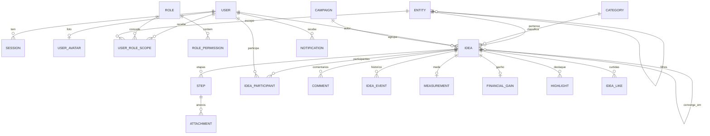

# Modelo de dados – novo sistema de melhoria contínua

> **Status: v0.1 (rascunho para revisão).** Base: [REGRAS-DE-NEGOCIO.md](REGRAS-DE-NEGOCIO.md) v1.0, [CRITERIOS-DE-ACEITE.md](CRITERIOS-DE-ACEITE.md) e [STACK-E-ARQUITETURA.md](STACK-E-ARQUITETURA.md). PostgreSQL + TypeORM.
> Este documento descreve o **modelo lógico** (tabelas, colunas principais, restrições e índices). O esquema final nasce das migrações.

## 1. Convenções

- Nomes de tabelas e colunas em **inglês**, `snake_case`, tabelas no singular. Mapeamento dos termos das regras:

| Termo das regras | Nome técnico |
|---|---|
| Ideia | `idea` |
| Etapa | `step` |
| Entidade | `entity` |
| Categoria | `category` |
| Perfil | `role` |
| Co-autor / participante | `idea_participant` |
| Convergência | `idea.converged_into_id` |
| Histórico | `idea_event` |
| Campanha | `campaign` |
| Ganho | `financial_gain` |
| Destaque (Hall) | `highlight` |

- Chaves primárias **UUID** (v7 quando possível, ordenável por tempo), exceto `idea_event` e `audit_log` (`bigserial`, para ordem estrita) e a tabela de sequência.
- Datas e horas em `timestamptz` (UTC). Datas sem hora (prazos de etapa, períodos de campanha) em `date`, interpretadas no fuso da instalação (CA-T.3).
- Todas as tabelas de negócio têm `created_at`; as editáveis têm `updated_at`.
- Estados são `enum` do Postgres (ou `varchar` com `CHECK`), definidos no backend e expostos no OpenAPI.
- Valores monetários em `numeric(14,2)`; nunca `float`.
- **Fase** indica quando a tabela entra (F1, F2, F3). Tabelas das fases futuras podem ser criadas só quando necessárias, por migração.

## 2. Visão geral (núcleo)

## 3. Identidade e acesso · F1

**`user`** (RN-41, RN-42, RN-70)
| Coluna | Tipo | Notas |
|---|---|---|
| id | uuid PK | |
| email | citext, único | **Login é somente por e-mail** [DECIDIDO]; com o login corporativo (M13) o e-mail continua sendo a chave do primeiro vínculo |
| name | varchar | |
| password_hash | varchar | Argon2id; nulo em usuários anonimizados e em contas criadas pelo login corporativo (RN-98) |
| status | enum | `active`, `disabled`, `anonymized` |
| locale | varchar | `pt-BR`, `en`; idioma da interface e dos e-mails (preferência da conta) |
| theme | enum | `system`, `light`, `dark`; preferência de tema da conta |
| nav_collapsed | bool | Menu lateral recolhido no computador (preferência da conta) |
| deadline_alert_days | int nulo | Dias de antecedência do alerta de prazo (RN-29); nulo = padrão da instalação |
| hide_name | bool | Opt-out de mural/ranking/Hall (RN-70) |
| failed_attempts, locked_until | int, timestamptz | Bloqueio temporário (RN-42) |
| last_login_at, anonymized_at, created_at, updated_at | timestamptz | |

**`user_avatar`** (RN-91): `id`, `user_id` FK **único** (no máximo uma foto por usuário), `stored_name` (gerado, nunca o nome enviado), `mime` (já normalizado para `image/webp`), `size_bytes`, `width`, `height`, `created_at`. Foto em tabela própria (e não numa coluna de `user`) para que o arquivo tenha ciclo de vida claro: substituir apaga o anterior, e anonimizar apaga o arquivo (RN-40). O arquivo fica no volume de armazenamento, atrás da mesma interface dos anexos.

**`session`**: `id`, `user_id` FK, `token_hash` único, `expires_at`, `revoked_at`, `ip`, `user_agent`, `created_at`. Desativar o usuário revoga as sessões (CA-RN-41.1).

**`password_reset`** (RN-42): `id`, `user_id` FK, `token_hash` único, `expires_at`, `used_at`. Uso único.

**`user_identity`** (RN-96, M13): `id`, `user_id` FK, `provider` (`microsoft` | `google`), `issuer`, `subject` (na Microsoft, `tid:oid`; no Google, `sub`), `email_at_link` (o e-mail do provedor no momento do vínculo, só para consulta), `created_at`, `last_login_at`. Único por (`provider`, `issuer`, `subject`) e único por (`user_id`, `provider`): uma pessoa tem no máximo um vínculo por provedor, e uma conta do provedor aponta para um usuário só. Depois do primeiro vínculo o login é achado por esses três campos, não pelo e-mail. Anonimizar o usuário apaga os vínculos (RN-40). Não guarda token nem claims do provedor.

**`role`** (§3): `id`, `name` único, `description`, `is_system` (perfis de fábrica não são apagados), `system_key` único e nulo (chave estável dos perfis de fábrica, `collaborator`, `analyst`, `manager`, `validator`, `admin`, para o seed reconhecê-los mesmo se o admin mudar o nome).
**`role_permission`**: `role_id` FK, `permission` varchar (código como `idea.triage`). PK composta. Os códigos vivem no código do backend (e são entregues ao frontend pela API), sem tabela de permissões.
**`user_role_scope`**: `id`, `user_id` FK, `role_id` FK, `entity_id` FK, `include_children` bool. Único por (`user_id`, `role_id`, `entity_id`). É onde "perfil **em** entidade" acontece (§3.2).

**`audit_log`** (RN-39): `id` bigserial, `at`, `actor_id` (nulo para o sistema), `action`, `target_type`, `target_id`, `data` jsonb sem valor padrão (o serviço sempre preenche; sem segredos), `ip`. Somente inserção: *trigger* recusa `UPDATE`, `DELETE` e `TRUNCATE`.

## 4. Organização e configuração · F1

**`entity`** (RN-25): `id`, `parent_id` FK, `name`, `active`, `mpath` (caminho materializado, gerido pelo TypeORM `@Tree('materialized-path')`), `created_at`.
- Índice em `mpath` com `text_pattern_ops` (descendentes por prefixo).
- Único (`parent_id`, `name`). Ciclo recusado pelo serviço de mover (CA-RN-25.1).

**`category`** (RN-24): `id`, `name` único, `color`, `active`, `sort_order`, `created_at`. Conjuntos prontos (Segurança + QDCEP, genérico) entram por *seed* idempotente.

**`setting`**: `key` PK, `value` jsonb, `updated_by`, `updated_at`. Todas as configurações do §16 das regras (prefixo, SLA, fuso, limites de anexo, módulos ligados, etc.).
- Só guarda o que difere do padrão: gravar o valor de fábrica apaga a linha (M10).
- Identidade visual (M10):
  - `branding.color`: hex `#RRGGBB` ou nulo, que vale o índigo do ITS.
  - `branding.color_dark`: ajuste opcional do escuro.
  - `branding.font`: `geist`, `inter`, `atkinson` ou `plex`.
- Ajuda (M11): `help.docs_url`, o endereço da documentação (padrão `/ajuda/`; caminho no mesmo endereço ou `https://`, sempre terminado em `/`).

**`organization_logo`** (M10, identidade visual): `variant` PK (`light` | `dark`), `stored_name`, `width`, `height`, `updated_at`.
- **Arquivo:** em `STORAGE_DIR/branding`, já em WebP aparado e sem metadados. O nome é gerado pelo sistema, nunca o enviado. Trocar apaga o arquivo anterior.
- **Linhas:** no máximo uma por tema. Sem a linha `dark`, o logo claro aparece sobre uma placa clara no tema escuro.
- **Versão:** o `updated_at` vira a versão no `?v=` da URL pública.

**`mail_provider`** (RN-90): `id`, `type` (`smtp`, `microsoft_graph` ou `google_workspace`, RN-99 e RN-101), `name`, `config_encrypted` (bytea, em AES-256-GCM com chave derivada da `APP_SECRET_KEY`: no SMTP, servidor, porta, segurança, usuário e senha; na Microsoft, tenant, ID do cliente, segredo, ID do objeto da caixa e "responder para"; no Google, e-mail da conta de serviço, chave privada e "responder para"), `from_address` (no Graph e no Google, a caixa remetente), `from_name` (sem efeito no Graph), `secret_expires_on` (date, nula: validade do segredo no tipo Microsoft e, opcional, da chave no tipo Google, RN-100), `active`, `last_test_at`, `last_test_ok`, `last_test_error`, `updated_by_id`. A senha só existe cifrada; a API não a devolve. Na v1 há uma linha só.

**`sso_provider`** (RN-96, RN-97, M13): `id`, `provider` único (`microsoft` | `google`), `client_id`, `tenant_id` (só Microsoft; nulo no Google), `config_encrypted` (bytea: `{clientSecret}` em AES-256-GCM com chave derivada da `APP_SECRET_KEY`, igual ao `mail_provider`), `enabled`, `secret_expires_on` (date, nula: validade do segredo, RN-100), `last_test_at`, `last_test_ok`, `last_test_error`, `updated_by_id`, `created_at`, `updated_at`. O segredo só existe cifrado e a API devolve apenas se ele está definido. Mudar cliente, segredo ou tenant zera o teste e desliga o provedor.
- Configurações do acesso corporativo em `setting`, **fora do PATCH genérico** (só a API de acesso altera, com validação e auditoria):
  - `auth.login_mode`: `password` (padrão), `password_sso` ou `sso`.
  - `auth.email_domains`: lista de domínios; vazia = sem restrição.
  - `auth.allow_external_email`: bool, falso de fábrica.
  - `sso.auto_create`: bool, falso de fábrica.
  - `sso.default_role_id` e `sso.default_entity_id`: perfil e entidade iniciais da criação automática (nulos até configurar).
  - `auth.sso_session_hours` (padrão 8, editável em Configurações): duração da sessão de quem entra por SSO.

**`email_template`** (RN-32): (`key`, `locale`) PK, `subject`, `body`, `updated_by_id`, `updated_at`. Só guarda o que o admin editou; sem linha, vale o texto de fábrica (no código). Chaves: `digest`, `password_reset`, `test`.

## 5. Ideias · F1 (campos de F2 e F3 marcados)

**`idea_sequence`** (RN-22): `year` PK, `last_value`. O número é obtido com `UPDATE ... RETURNING` dentro da mesma transação que insere a ideia. Se a transação falhar, o número volta, e assim não há lacuna (CA-RN-22.2).

**`idea`**
| Coluna | Tipo | RN | Notas |
|---|---|---|---|
| id | uuid PK | | |
| code | varchar único | RN-22 | `ITS-2026-0042`; imutável |
| title, description | varchar, text | RN-03 | |
| proposed_solution, expected_gain | text, nulos | RN-03 | |
| status | enum | RN-02 | `submitted`, `in_review`, `in_progress`, `implemented`, `rejected` |
| entity_id | FK | RN-25 | |
| category_id | FK, nulo | RN-24 | Principal |
| external_ref | varchar(100), nulo | RN-23 | Não único |
| author_id | FK `user`, nulo | RN-02 | Nulo apenas se anonimizado |
| registered_by_id | FK `user`, nulo | RN-04 | Quem cadastrou em nome de outro |
| is_anonymous | bool | D5 | Envio anônimo (configurável) |
| assigned_to_id | FK `user`, nulo | RN-55 | Analista responsável pela triagem |
| submitted_at | timestamptz | | Base da regra "a mais antiga vigora" (RN-84) |
| review_started_at, decided_at, implemented_at | timestamptz, nulos | | |
| rejection_reason, result_text | text, nulos | RN-05, RN-07 | |
| sla_due_at, sla_alerted_at | timestamptz, nulos | RN-54 | F2 |
| impact, effort | smallint 1–5, nulos | RN-56 | F2; `CHECK` |
| standard_adopted, is_replicable | text, bool | RN-64 | F2 |
| origin_idea_id | FK `idea`, nulo | RN-64 | F2; ideia replicada |
| campaign_id | FK, nulo | RN-51 | F2 |
| public_code | varchar(64) único | RN-34 | 256 bits de fonte criptográfica (base64url, 43 caracteres). Nasce com a ideia; nas ideias que já existiam quando a coluna foi criada, 244 bits em hexadecimal |
| public_enabled | bool | RN-37 | Padrão `true`; só o autor altera. Vale se a consulta estiver ligada na instalação (`public.lookup_enabled`) |
| converged_into_id | FK `idea`, nulo | RN-84 | F2; `CHECK (converged_into_id <> id)` |
| converged_at, converged_by_id, converged_reason | | RN-85 | F2 |
| archived_at | timestamptz, nulo | RN-11 | Arquivamento lógico |
| search_text | tsvector/texto, gerado | RN-57 | Somente leitura na entidade (ver §3.2 da stack) |
| created_at, updated_at | | | |

Índices: (`entity_id`, `status`); (`author_id`); (`status`, `submitted_at`) parcial onde `converged_into_id IS NULL AND archived_at IS NULL` (filas); (`assigned_to_id`, `status`); (`campaign_id`); único em `public_code`; GIN trigram em `search_text` (criado na migração).
Restrições: o estado `implemented` exige `implemented_at` e `result_text`; `rejected` exige `rejection_reason`; encerrada nunca aceita edição (RN-08 é regra de serviço, com teste CA-RN-08.1). Os `CHECK` (`ck_idea_implemented`, `ck_idea_rejected`, `ck_step_position`, `ck_step_dates`) nascem numa migração escrita à mão e também são declarados nas entidades com `@Check`, para o gerador de migrações reconhecê-los (ele compara pelo nome).

**`idea_category`** (tags, RN-24): (`idea_id`, `category_id`) PK.

**`idea_participant`** (RN-69, RN-86): `id`, `idea_id` FK, `user_id` FK, `role` (`author`, `executor`, `co_author`), `origin` (`original`, `support`, `converged`, `manual`), `note` (texto de apoio ou de complemento), `added_by`, `added_at`. Único (`idea_id`, `user_id`, `role`). O autor original é uma linha com `role = author`; mínimo de um autor (CA-RN-69.1).

**`step`** (RN-12 a RN-17): `id`, `idea_id` FK, `position` int, `name`, `description`, `assignee_id` FK, `start_date`, `due_date`, `completed_at` nulo, `pdca_phase` enum nulo (F2, RN-60), `created_at`, `updated_at`.
- Único (`idea_id`, `position`) — impede posição repetida em concorrência (CA-RN-14.2).
- `CHECK (due_date >= start_date)` (RN-16).
- Índice parcial em `due_date` onde `completed_at IS NULL` (`ix_step_open_due`, alertas, RN-29).

**`attachment`** (RN-21): `id`, `idea_id` FK, `step_id` FK nulo, `original_name`, `stored_name` (gerado, nunca o nome enviado), `mime`, `size_bytes`, `uploaded_by`, `created_at`.

**`comment`** (RN-28): `id`, `idea_id` FK, `author_id` FK, `body`, `visibility` (`public`, `internal`), `created_at`. Índice (`idea_id`, `created_at`).

**`idea_event`** (RN-38, RN-58): `id` bigserial, `idea_id` FK, `type` (`created`, `status_changed`, `step_added`, `deadline_changed`, `assigned`, `converged`, `convergence_undone`, `reopened`, …), `actor_id` nulo (sistema), `at`, `reason` nulo, `data` jsonb, `visibility` (`public`, `internal`). Índice (`idea_id`, `at`).
- **Imutável:** um *trigger* (`BEFORE UPDATE OR DELETE`) criado na migração lança erro em qualquer alteração ou exclusão, tanto nesta tabela quanto em `audit_log` (CA-RN-38.2). Há um único usuário de banco (ver §9).
- **Única exceção, a exclusão física pelo administrador (RN-11):** o serviço marca `set_config('its.purge_idea', <id>, true)` na própria transação; o *trigger* de `idea_event` aceita o `DELETE` só das linhas dessa ideia, e só dentro dessa transação. A exclusão fica registrada em `audit_log`, que nunca aceita `DELETE`.

**`saved_filter`** (RN-59): `id`, `user_id` FK, `name`, `definition` jsonb. F2.
**`triage_rule`** (RN-55): `id`, `entity_id` FK nulo, `category_id` FK nulo, `assignee_id` FK, `priority` int. F2.

## 6. Comunicação · F1

**`notification`** (RN-27): `id`, `user_id` FK, `type`, `idea_id` FK nulo, `payload` jsonb, `in_app` (falso quando a pessoa só quer o e-mail daquele aviso), `email_state` (`none`, `pending`, `digested`: aguardando ou já incluída no resumo diário), `read_at` nulo, `created_at`. Índice (`user_id`, `read_at`, `created_at`) e índice parcial em `user_id` onde `email_state = 'pending'`.
**`notification_preference`** (RN-30): (`user_id`, `event_type`, `channel`) PK, `enabled`.
**`email_log`** (RN-30, RN-31): `id`, `kind` (chave do modelo), `user_id` FK nulo, `to_address`, `subject`, `body_encrypted` (bytea; pode ter link de recuperação de senha), `status` (`pending`, `sent`, `failed`), `attempts`, `last_error`, `queued_at`, `sent_at`, `created_at`. É a fila de saída: o worker cria o job do pg-boss e marca `queued_at` na mesma transação; esta tabela é o rastro para a tela "Envios". Sem `notification_id`: um resumo diário junta vários avisos.
**`alert_dedup`**: chave primária (`kind`, `target_id`, `day`, `user_id`), `created_at`. Alerta de prazo: `kind` = `deadline_soon` ou `deadline_due`, alvo = etapa, `day` = data prevista (um de cada por etapa, prazo e pessoa). Resumo diário: `kind` = `digest`, `day` = hoje no fuso da instalação (um por pessoa por dia). Garante CA-RN-29.2 e CA-T.1.

## 6.1 Observabilidade · F1 (M12)

Três tabelas pequenas, só de operação. Nenhuma guarda dado pessoal, URL crua ou identificador de ideia (CA-T.11).

**`ops_heartbeat`** (RN-93): chave primária (`process`, `instance`), em que `process` é `api` ou `worker` e `instance` é o nome da máquina (contêiner). Colunas: `started_at`, `last_seen_at`, `memory_mb`, `event_loop_p99_ms` (nulo no worker), `storage_free_pct` (só na API: percentual livre do volume dos anexos), `last_tick_ms` (só no worker), `version`. Cada processo regrava a própria linha a cada minuto; a saúde usa o `last_seen_at` mais recente de cada `process`. Linhas sem batimento há mais de 1 dia são apagadas pela limpeza (contêiner recriado muda o nome da máquina).
**`ops_metric_hour`** (RN-92): chave primária (`hour`, `process`), com `hour` truncada na hora em UTC. Colunas: `requests`, `errors_4xx`, `errors_5xx`, `rate_limited` (429), `logins_ok`, `logins_failed`, `latency_buckets` jsonb (12 inteiros: faixas até 5, 10, 25, 50, 100, 250, 500, 1000, 2500, 5000 e 10000 ms, mais o que passar disso), `memory_mb` (o maior da hora), `routes` jsonb (as 20 rotas mais pedidas e as que tiveram 5xx: `route`, `requests`, `errors`, `latency_buckets`), `worker` jsonb (só no worker: `ticks`, `tick_buckets`, `emails_sent`, `emails_failed`, `emails_retried`), `created_at`, `updated_at`. A gravação é **aditiva**: o serviço lê a linha com trava, soma contadores e faixas e grava na mesma transação, então várias instâncias, ou um reinício dentro da hora, não perdem nem duplicam medidas. Os percentis (p50, p95, p99) são calculados na leitura a partir das faixas somadas. A limpeza apaga o que passa de `ops.retention_days`.
**`ops_alert_state`** (RN-94): chave primária `item_key` (`database`, `migrations`, `storage`, `email`, `email_queue`, `email_secret`, `sso_secret`, `integration_token`, `webhook_secret`, `webhook_delivery`, `worker`, `api`). Colunas: `state` (`ok` ou `failed`), `clean_checks` (conferências seguidas sem falha desde que falhou), `last_failure_notice_at` (nulo), `silenced` (a falha caiu nos 30 minutos e não avisou, então a volta também não avisa), `since`, `updated_at`. O alerta lê e grava esta linha numa transação com `FOR UPDATE`.

## 6.2 Integrações · F1 (M16)

Quatro tabelas para a API de integração (RN-102 a RN-116). Os **interruptores** (chave geral `integration.enabled` e módulos ligados `integration.modules`) ficam em `setting`, não em tabela. Nenhuma das tabelas guarda o token, dado pessoal, URL crua, parâmetro ou IP (CA-T.13, CA-RN-113.9).

**`integration`** (RN-103): `id` (UUID v7), `name`, `name_key` (o nome em minúsculas, **único**), `owner` (texto livre: o responsável), `status` (`active`, `suspended`, `revoked`), `modules` (`text[]`, só os seis códigos: `ideas`, `indicators`, `campaigns`, `hall`, `entities`, `users`), `include_email` (booleano, falso de fábrica: RN-112), `rate_per_minute` (inteiro, `CHECK` de 1 a 600, padrão 60), `ip_allowlist` (`text[]` de IPs ou faixas CIDR, `CHECK` de no máximo 20 itens; vazio = qualquer origem), `created_by_id` FK `user`, `created_at`, `updated_at`, `revoked_at` (nulo). A integração **não** é uma linha de `user`.
**`integration_scope`** (RN-103): (`integration_id`, `entity_id`) PK, ambos FK, `include_children` (booleano). Sem linha nenhuma, a integração não enxerga nada. O escopo é expandido pela árvore (`mpath`) do mesmo modo que o escopo de perfis (§3.2).
**`integration_token`** (RN-104): `id`, `integration_id` FK, `token_hash` (**único**; é o SHA-256 do token, como `session.token_hash`), `prefix` (`its_` mais 4 caracteres, só para a pessoa reconhecer o token na tela), `expires_at` (**obrigatória**, `CHECK (expires_at <= created_at + interval '365 days')`), `retire_at` (nulo; fim da sobreposição de um token que foi girado, nunca depois de `expires_at`), `revoked_at` (nulo), `last_used_at` (nulo; gravada no máximo uma vez por minuto), `created_by_id` FK `user`, `created_at`. O valor do token **nunca** é gravado. Um token vale se não está revogado, `now() < expires_at` e (`retire_at` nulo ou `now() < retire_at`). O limite de **2 tokens ativos** por integração é conferido no serviço, dentro de transação com trava na linha da integração (`SELECT ... FOR UPDATE`, CA-T.2).
**`integration_hour`** (RN-113): chave primária (`hour`, `integration_id`, `module`), com `hour` truncada na hora em UTC. Colunas: `requests`, `errors_4xx`, `errors_5xx`, `rate_limited` (429), `updated_at`. A gravação é **aditiva** (lê com trava, soma e grava na mesma transação), como a `ops_metric_hour`, para várias instâncias da API não perderem nem duplicarem contagem. Falha de autenticação **não** entra aqui (não se liga a nenhuma integração). A limpeza do worker apaga o que passa de `ops.retention_days`.

A auditoria (RN-114) usa o `audit_log` que já existe: o `actor_id` é o administrador e a integração vai em `data` (`integrationId`, `name`); a leitura pela API não grava nada ali.

## 6.3 Webhooks de saída · F1 (M17)

Quatro tabelas para os webhooks (RN-117 a RN-125). Os **interruptores** (`integration.webhooks_enabled` e `integration.webhook_destinations`) ficam em `setting`. Nenhuma tabela guarda dado pessoal, o corpo das respostas dos destinos ou o segredo em claro (CA-T.16).

**`webhook_subscription`** (RN-118): `id` (UUID v7), `integration_id` FK (cascata), `name`, `url` (texto; pode ter segredo na consulta, então só a tela do administrador a mostra), `events` (`text[]`, só os códigos da RN-119), `status` (`active`, `suspended`), `suspended_reason` (`admin`, `failures`; nulo se ativa), `consecutive_failures` (inteiro, zera a cada entrega), `created_by_id` FK `user`, `created_at`, `updated_at`. `UNIQUE (integration_id, name)`; no máximo 5 por integração (conferido no serviço, com a linha da integração travada).
**`webhook_secret`** (RN-120): `id`, `subscription_id` FK (cascata), `secret_encrypted` (`bytea`, AES-256-GCM pelo `secret-box`: o HMAC precisa dele em claro na hora de assinar), `prefix` (`whsec_` mais 4 caracteres, só para reconhecer na tela), `expires_at` (obrigatória, `CHECK (expires_at <= created_at + interval '365 days')`), `retire_at` (nulo; fim da sobreposição numa rotação), `revoked_at` (nulo), `created_at`. No máximo 2 ativos por assinatura (conferido no serviço).
**`webhook_event`** (RN-119): `id` (UUID v7, é o `X-ITS-Event-Id`), `type`, `data` (`jsonb`, só identificadores e estado), `entity_id` (nulo; a entidade da ideia, para o escopo), `origin_integration_id` FK `integration` nula (preenchida no M18, para o eco), `created_at`. Gravada **na mesma transação** da mudança de negócio.
**`webhook_delivery`** (RN-121, RN-122): `id`, `event_id` FK (cascata), `subscription_id` FK (cascata), `state` (`pending`, `delivered`, `failed`), `attempts`, `next_attempt_at`, `last_status` (HTTP; nulo), `last_error` (código curto; nulo), `delivered_at`, `created_at`. `UNIQUE (event_id, subscription_id)`; índice parcial em `next_attempt_at` onde `state = 'pending'` (a fila do worker, lida com `SKIP LOCKED`).

A auditoria (RN-124) usa o `audit_log`, guardando só o **host** da URL. A retenção de `webhook_event` e `webhook_delivery` segue `ops.retention_days`.

## 6.4 Escrita pela API · F1 (M18)

Ajustes e uma tabela nova para a escrita (RN-126 a RN-134):

- **`integration.modules`** e **`integration_hour.module`**: os `CHECK` passam a aceitar os **oito** códigos (os seis da leitura mais `ideas_write` e `gains_write`).
- **`idea`**: coluna `source_integration_id` (FK `integration`, `ON DELETE SET NULL`, nula): a origem "via Integração X" (RN-133).
- **`comment`**: coluna `source_integration_id` (mesma FK, nula) e `author_id` **anulável** (um comentário de integração não tem pessoa autora; a tela mostra o nome da integração).
- **`idea_event`**: o dado do evento de histórico leva `integrationId` quando a origem é uma integração (sem coluna nova; vai no `jsonb`).
- **`integration_idempotency`** (RN-131): chave primária (`integration_id`, `route`, `key`), `request_hash` (SHA-256 do corpo), `state` (`in_progress`, `done`), `status` (HTTP), `response` (`jsonb`, a resposta mínima), `created_at`. A chave é reservada com `INSERT ... ON CONFLICT DO NOTHING`; a limpeza do worker apaga o que passou de 24 horas.

## 7. Resultado e campanhas · F2

**`measurement`** (RN-61): `idea_id` PK/FK, `indicator`, `unit`, `direction` (`increase`, `decrease`), `baseline`, `target`, `achieved` (`numeric(18,4)`). Na ideia: `step_model` (`free`, `pdca`) e, na etapa, `pdca_phase` (RN-60).
**`financial_gain`** (RN-62, RN-63): `idea_id` PK/FK, `currency` (ISO 4217; padrão `results.currency`), `periodicity` (`once`, `monthly`, `yearly`), `estimated`, `realized`, `implementation_cost` (`numeric(14,2)`), `status` (`declared`, `validated`), `validated_by_id`, `validated_at`. `CHECK` de valores ≥ 0 e de validado com realizado e data.
**`sustainment_review`** (RN-65): `id`, `idea_id` FK, `due_on` (date, no fuso da instalação), `status` (`pending`, `confirmed`, `contested`), `reviewed_by_id`, `reviewed_at`, `note`, `created_at`. Índice parcial em `due_on` onde `status = 'pending'`. O lembrete usa `alert_dedup` (uma vez por revisão e pessoa).
**`campaign`** (RN-50): `id`, `name`, `objective`, `starts_on`, `ends_on`, `goal_type` (`ideas`, `gain`, `qualitative`), `goal_value`, `goal_text`, `reward_note`, `status` (`draft`, `active`, `closed`), `created_by_id`, `closed_at`, `summary` (jsonb, gravado ao encerrar, RN-53). `CHECK (ends_on >= starts_on)` e `CHECK (goal_type = 'qualitative' OR goal_value > 0)`.
**`campaign_entity`**, **`campaign_category`**: tabelas de ligação (alvos).

## 8. Reconhecimento e Hall · F3

**`season`** (RN-66): `id`, `name`, `starts_on`, `ends_on`, `campaign_id` nulo.
**`point_ledger`** (RN-66, RN-89): `id`, `user_id` FK, `idea_id` FK nulo, `event_type` (`idea_submitted`, `idea_approved`, `idea_implemented`, `idea_highlighted`), `points`, `season_id` FK nulo (temporada vigente no dia), `created_at`. **Único** (`user_id`, `idea_id`, `event_type`) para pontuar uma só vez (CA-RN-66.1). Livro-razão: nunca atualizado, só inserido; o ranking é soma.
**`level`** (RN-67): `id`, `name`, `min_points` (único; a ordem vem dele).
**`achievement`** (RN-68): `id`, `code` único, `name`, `description`, `rule_type` (`ideas_submitted`, `ideas_implemented`, `points`), `threshold`, `active`. **`user_achievement`**: (`user_id`, `achievement_id`) PK, `granted_at`.
**`idea_like`** (RN-76): (`idea_id`, `user_id`) PK, `created_at`.
**`highlight`** (RN-72, RN-78, RN-79): `id`, `idea_id` FK, `scope` (`entity`, `organization`; a entidade é a da ideia), `justification`, `starts_on`, `ends_on`, `status` (`active`, `expired`, `revoked`), `curated_by_id` (nulo = entrada automática), `revoked_reason`, `revoked_at`, `created_at`.
**`highlight_consent`** (RN-74): (`highlight_id`, `user_id`) PK, `role` (`author`, `co_author`), `status` (`pending`, `accepted`, `declined`), `answered_at`.
**`hall_dismissal`** (CA-RN-72.3): `idea_id` PK, `dismissed_by_id`, `dismissed_at`: candidata recusada não volta a ser sugerida.
**`highlight_praise`** (RN-77): `id`, `highlight_id` FK, `author_id` FK, `body`, `hidden_at`, `hidden_by`, `hidden_reason`, `created_at`.
**`reward_record`** (RN-71): `id`, `idea_id` FK nulo, `user_id` FK, `description`, `granted_on` (date), `registered_by_id`. Registro informativo, sem fluxo de pagamento.

## 9. Regras garantidas pelo banco (defesa em profundidade)

Para cada regra crítica, o banco é a **segunda trava**, além do serviço:

| Garantia | Mecanismo | Critério |
|---|---|---|
| Identificador único e sem lacuna | `idea_sequence` + `UNIQUE (code)` | CA-RN-22.2 |
| Posição de etapa sem repetição | `UNIQUE (idea_id, position)` | CA-RN-14.2 |
| Data prevista ≥ início | `CHECK` | CA-RN-16.1 |
| Impacto/esforço de 1 a 5 | `CHECK` | CA-RN-56.1 |
| Histórico e auditoria imutáveis | *Trigger* que bloqueia `UPDATE`/`DELETE` em `idea_event` e `audit_log` | CA-RN-38.2 |
| Ideia não converge em si mesma | `CHECK (converged_into_id <> id)` | CA-RN-84.3 |
| Uma curtida por pessoa | PK composta | CA-RN-76.1 |
| Ponto concedido uma só vez | `UNIQUE` no livro-razão | CA-RN-66.1 |
| Alerta único por dia | `UNIQUE` em `alert_dedup` | CA-RN-29.2 |
| Código público não adivinhável | `UNIQUE` + geração criptográfica | CA-RN-34.1 |
| Uma linha de métrica por hora e processo | PK composta em `ops_metric_hour` | CA-RN-92.3 |
| Um estado de alerta por item | PK em `ops_alert_state` | CA-RN-94.7 |
| Um vínculo por pessoa e provedor; uma conta do provedor para um usuário | `UNIQUE` em `user_identity` | CA-RN-96.2, CA-RN-96.3 |
| Um provedor de login por tipo | `UNIQUE (provider)` em `sso_provider` | CA-RN-97.7 |
| Nome de integração único, sem diferenciar maiúsculas | `UNIQUE (name_key)` em `integration` | CA-RN-103.1 |
| Token único e nunca guardado em claro | `UNIQUE (token_hash)` em `integration_token` (só o hash existe) | CA-RN-104.2 |
| Token com validade de até 365 dias | `CHECK` em `integration_token` | CA-RN-104.3 |
| Limite de 1 a 600 por minuto; até 20 IPs | `CHECK` em `integration` | CA-RN-105.2, CA-RN-103.8 |
| Módulos só entre os seis códigos | `CHECK` em `integration.modules` | CA-RN-102.7 |
| Uma linha de consumo por hora, integração e módulo | PK composta em `integration_hour` | CA-RN-113.6 |
| Nome de assinatura único por integração | `UNIQUE (integration_id, name)` em `webhook_subscription` | CA-RN-118.7 |
| Segredo de webhook com validade de até 365 dias | `CHECK` em `webhook_secret` | CA-RN-120.4 |
| Uma entrega por evento e assinatura | `UNIQUE (event_id, subscription_id)` em `webhook_delivery` | CA-RN-119.6 |
| Chave de idempotência única por integração e rota | PK composta em `integration_idempotency` | CA-RN-131.2, CA-RN-131.4 |
| Oito módulos de integração, nenhum a mais | `CHECK` em `integration.modules` e `integration_hour.module` | CA-RN-126.5 |

Ciclos de convergência e a regra "só encerradas podem ser reabertas" são verificados no serviço, dentro de transação com trava na ideia (`SELECT ... FOR UPDATE`), para evitar corridas (CA-T.2).

## 10. Dados iniciais (seed, idempotente)

- Perfis de fábrica: Colaborador, Analista, Gestor, Validador de resultados, Administrador, com as permissões do §3.1 (códigos em `backend/src/identity-access/permissions.ts`). O seed roda ao iniciar a API, sob a mesma trava das migrações; cria só os perfis que faltam e não desfaz edições do admin, exceto que o Administrador sempre recebe as permissões novas.
- A permissão `ops.view` (observabilidade, RN-92) entra só no Administrador de fábrica; os outros perfis ganham por concessão do admin. O mesmo vale para `sso.manage` (acesso corporativo, RN-95 a RN-98) e para `integration.manage` (integrações, RN-102). A chave geral das integrações (`integration.enabled`) nasce **desligada** e nenhum módulo nasce ligado.
- Conjuntos de categorias opcionais (Segurança + QDCEP; genérico).
- Modelos de e-mail em pt-BR e en.
- **Sem usuário nem senha padrão:** o administrador nasce no assistente de instalação (RN-43).

## 11. Retenção e privacidade (RN-40)

- Anonimização troca nome e e-mail por valores neutros, **apaga a foto** (registro em `user_avatar` e arquivo no armazenamento) **apaga os vínculos do login corporativo** (`user_identity`) e zera `password_hash`; mantém as chaves, para as ideias continuarem apontando para o registro ("Ex-colaborador").
- `audit_log` e `idea_event` guardam o `actor_id`, mas não dados pessoais em texto; a anonimização do usuário basta.
- Exclusão física de ideia só por admin, com registro (RN-11).
- `webhook_event` e `webhook_delivery` (M17) e `integration_idempotency` (M18, 24 horas) também têm retenção; `ops_metric_hour` e `integration_hour` são as tabelas com retenção por tempo (`ops.retention_days`, padrão 30 e máximo 90 dias); `integration` e `integration_token` ficam (revogar não apaga a linha, para o histórico e a auditoria continuarem apontando para ela); `audit_log` e `idea_event` continuam sem expiração, por serem imutáveis. O tamanho delas aparece na tela de observabilidade (RN-92) para o administrador acompanhar o crescimento.

## 12. Decisões fechadas

1. **Login somente por e-mail** [DECIDIDO]. Não existe coluna `username`. Desde o M13 a pessoa pode entrar por senha ou, se o administrador ligar, por Microsoft/Google; o identificador dela é o e-mail e o vínculo com o provedor é guardado em `user_identity`.
2. **Chaves primárias em UUID v7** [DECIDIDO], gerado no código da aplicação.
3. **Um único usuário de banco** [DECIDIDO]. Os testes nunca tocam o banco principal (ver [STACK-E-ARQUITETURA.md](STACK-E-ARQUITETURA.md), §10), então não há motivo para separar dono das migrações e usuário da aplicação. A imutabilidade do histórico passa a ser garantida por *trigger* (§9).
   - **Limite conhecido:** como o usuário é dono do esquema, quem conseguisse executar SQL arbitrário (por exemplo, por uma injeção de SQL) poderia remover o *trigger*. O trigger protege contra bugs e contra uso indevido de rotas, não contra um invasor com acesso total ao banco. Para o público-alvo isso é aceitável; o uso de consultas parametrizadas e o CA-T.4 reduzem o risco.
