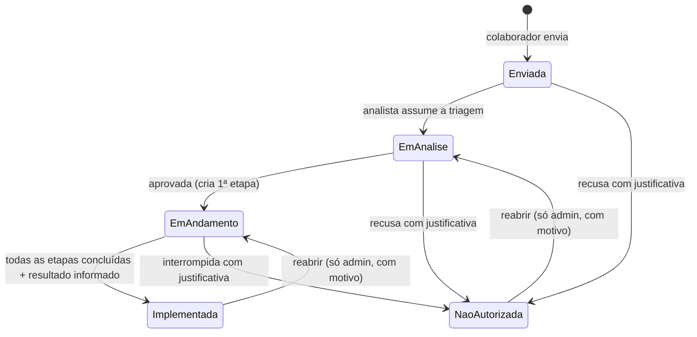

# Regras de negócio – novo sistema de melhoria contínua (open source)

> **Status: v1.0 consolidada (base para os critérios de aceite).** Decisões D1–D7 aprovadas pelo autor ("de acordo"); D8–D15 adotadas conforme a recomendação, sujeitas a veto. Os critérios testáveis de cada RN estão em [CRITERIOS-DE-ACEITE.md](CRITERIOS-DE-ACEITE.md). Histórico: v0.1 base; v0.2 Aevo/Hall; v0.3 convergência; **v1.0** decisões fechadas. Itens marcados **[DECIDIDO]** vieram de decisões já tomadas; **[PROPOSTA]** são recomendações a validar.
>
> Referências: artigo "Melhoria contínua" da Aevo (aevo.com.br/melhoria-continua; conteúdo de marketing, usado só como inspiração de práticas) e GLPI.
> Base: decisões do autor e referência de produto: GLPI (uma instalação por organização, perfis e entidades configuráveis).

---

## 1. Princípios de projeto

1. **Genérico por configuração, não por código.** Nada de unidades, categorias ou textos fixos no código. Quem instala configura.
2. **Uma instalação = uma organização** (como o GLPI). Dentro dela existem **entidades** (unidades, áreas, filiais) em árvore. Multi-organização no mesmo banco fica fora do escopo. **[PROPOSTA]**
3. **A ideia é o centro.** Qualquer colaborador envia; a equipe trata; o autor recebe retorno. **[DECIDIDO]**
4. **Tudo que muda de estado deixa rastro** (quem, quando, por quê).
5. **Segurança por padrão:** nada de escrita pública; consulta pública é opcional e limitada. **[DECIDIDO]**
6. **Metodologia-agnóstico:** o fluxo serve para qualquer programa de ideias ou melhorias, sem termo de metodologia: a ideia se chama "ideia" do envio ao fim da execução.
7. **Transparência e reconhecimento fazem parte do produto:** quem envia sabe em que pé está a ideia, e boas ideias são celebradas (Hall). Falta de retorno é a principal causa de baixo engajamento.

---

## 2. Glossário

| Termo | Definição |
|---|---|
| **Ideia** | Proposta enviada por um colaborador. Ainda não é trabalho aprovado. |
| **Etapa** | Passo de execução da ideia, com responsável, datas e conclusão. |
| **Categoria** | Classificação configurável. Ex.: Segurança, Qualidade, Entrega, Custo, Meio ambiente, Pessoas. |
| **Entidade** | Nó da estrutura organizacional (empresa > unidade > setor). Substitui as "unidades" fixas. |
| **Perfil** | Conjunto de permissões (colaborador, analista, gestor, admin…). |
| **Código de acompanhamento** | Código público e não adivinhável para consultar andamento sem login. Substitui o "protocolo" de 7 dígitos. |
| **Campanha** | Desafio temático com período, foco e meta. Agrupa ideias de um mesmo objetivo estratégico. |
| **Hall de destaques** | Mural de reconhecimento com as melhores ideias e colaboradores. |
| **Saldo da loja** | O que cada pessoa tem para trocar na loja (M22), separado dos pontos ganhos: resgatar reduz o saldo, nunca os pontos, o nível ou o ranking. Vem de um extrato que não se apaga (RN-159 a RN-173). |
| **Bonificação** | Item da loja com valor em dinheiro apenas informativo (bônus, ticket, vale): o ITS registra e acompanha até o RH marcar como paga, mas nunca paga (RN-167). |
| **Aprovação de outra área** | Aval que a equipe de melhoria pede a quem responde por uma mudança ou por uma área afetada, com ou sem usuário no ITS (por um link de uso único). Não muda a ideia sozinha (M24, RN-183 a RN-192). |
| **Aviso na tela** | Mensagem rápida no canto da tela que confirma o resultado de uma ação (sucesso ou erro) e some sozinha (M23, RN-174 e RN-175). Não confundir com as **notificações** do sino, que ficam guardadas. |
| **Campo personalizado** | Dado sobre a pessoa que a própria organização cria (até 8), como matrícula, CPF ou departamento: aberto (digitado e tipado) ou fechado (escolhido numa lista). Pode ser obrigatório no cadastro (M25, RN-193 a RN-202). |
| **Tela de login** | As telas de acesso (entrar, esqueci a senha, definir a senha), que a organização personaliza com layout, fundo e textos (M23, RN-176 a RN-181). |
| **Mural de ideias** | Início do ITS (M21, quando ligado) com as ideias Em andamento e Implementadas que a equipe de melhoria publicou, para todos os logados reagirem, conversarem e compartilharem. O autor só aparece se consentir (RN-148 a RN-158). |
| **Ganho validado** | Ganho realizado confirmado por quem tem a permissão de validar (ex.: controladoria). |
| **Coautor** | Participante de uma ideia (autor, executor, ou solicitante que teve a ideia convergida). |
| **Convergência** | União de solicitações semelhantes em uma ideia principal (a mais antiga), mantendo os demais solicitantes como co-autores. |
| **Identificador** | Número sequencial legível por humanos (ex.: `ITS-2026-0042`). Gerado pelo sistema, nunca digitado à mão. |
| **Integração** | Sistema externo (Power Automate, n8n, BI, ERP) que lê dados do ITS pela API de integração (`/integration/v1`). É uma identidade de serviço, não um usuário: não tem perfil, sessão nem tela. O administrador a cria, escolhe os módulos e o escopo de entidades (RN-103). |
| **Token de integração** | Chave secreta (`its_…`) que a integração envia no cabeçalho `Authorization: Bearer`. Tem validade obrigatória, é mostrada uma única vez e só o hash fica guardado (RN-104). |
| **Webhook** | Aviso que o ITS envia a um endereço de outro sistema quando algo acontece (ideia enviada, situação mudou...). O aviso é mínimo e assinado; quem recebe busca o detalhe pela API de leitura (RN-117 a RN-125). |
| **Idempotency-Key** | Cabeçalho que a integração manda em cada gravação para que repetir a chamada (por falha de rede, por exemplo) não duplique nada (RN-131). |

---

## 3. Atores e perfis

### 3.1 Perfis iniciais (editáveis) **[PROPOSTA]**

| Perfil | Quem é | Pode |
|---|---|---|
| **Colaborador** | Qualquer funcionário | Enviar ideias; ver e comentar as **suas**; ver o Hall e **curtir** ideias; ver ideias públicas da própria entidade (se a organização permitir); receber retorno |
| **Analista** | Equipe responsável | Tudo do colaborador + triar, aprovar/recusar, criar e gerenciar etapas e anexos, atribuir responsáveis, cadastrar ideia em nome de outra pessoa, ver todas as ideias das entidades que gerencia |
| **Gestor** | Líder de área/entidade | Leitura de todas as ideias das entidades dele, dashboards e relatórios; comentar; **criar campanhas e destacar ideias no Hall** da entidade; **não** altera etapas |
| **Validador de resultados** *(opcional)* | Controladoria/finanças | Permissão `ganho.validar`; leitura dos ganhos e relatórios financeiros |
| **Administrador** | TI / dono do sistema | Tudo: usuários, perfis, entidades, categorias, configurações, reabrir ideia, logs |

### 3.2 Modelo de permissões **[PROPOSTA]**
- Permissões são **granulares** (ex.: `ideia.enviar`, `ideia.triar`, `etapa.gerenciar`, `ideia.reabrir`, `usuario.gerenciar`, `relatorio.ver`).
- **Perfil** = conjunto de permissões. Os 4 acima vêm de fábrica; o admin pode editar e criar outros (como no GLPI).
- **Escopo por entidade:** um usuário recebe um perfil **em** uma ou mais entidades, com opção "incluir sub-entidades". O escopo limita o que ele enxerga e gerencia.
- Um usuário pode ter perfis diferentes em entidades diferentes (ex.: colaborador no setor A, analista na unidade B).
- Exceção fixa: **o autor sempre vê a própria ideia**, qualquer que seja o escopo.
- **Integrações** (M16) não usam perfis: cada uma é uma identidade de serviço com módulos e escopo de entidades próprios (RN-102 a RN-104). A única permissão envolvida é a de quem as administra, `integration.manage`.

> **RN-01** Toda rota e tela verifica permissão **e** escopo. Nenhuma regra de acesso é só visual.

---

## 4. Ciclo de vida da ideia

| Status | Significado |
|---|---|
| **Enviada** | Recebida, aguardando triagem |
| **Em análise** | Um analista assumiu a triagem |
| **Em andamento** | Aprovada e em execução (tem etapas) |
| **Implementada** | Executada e encerrada |
| **Não autorizada** | Recusada ou interrompida, com justificativa |

### 4.1 Regras do ciclo

- **RN-02** Qualquer colaborador pode enviar uma ideia. O status inicial é **Enviada**; o autor fica registrado automaticamente (não se escolhe o autor).
- **RN-03** Campos obrigatórios do envio: título, descrição do problema/situação atual e entidade. Opcionais (configuráveis): categoria, solução proposta, ganho esperado, anexos.
- **RN-04** Um analista pode **cadastrar em nome de outra pessoa**: registra-se o autor real e quem cadastrou.
- **RN-05** Ao **recusar** (Não autorizada) a **justificativa é obrigatória** e é enviada ao autor.
- **RN-06** Ao **aprovar** (Em análise → Em andamento), o sistema cria a primeira etapa e exige um responsável.
- **RN-07** Só é possível marcar como **Implementada** se existir ao menos uma etapa e **todas** estiverem concluídas. Também se informa o **resultado/ganho obtido** (texto e, opcionalmente, valor numérico).
- **RN-08** Em **Implementada** e **Não autorizada** a ideia fica **somente leitura**.
- **RN-09 [DECIDIDO]** **Reabrir** uma ideia encerrada exige permissão `ideia.reabrir` (por padrão, só Administrador), **motivo obrigatório** e fica no histórico.
- **RN-10** Ninguém recebe status "Em andamento" ou "Implementada" "na mão": as transições só acontecem pelas ações do fluxo (triar, aprovar, concluir…), nunca por edição livre do campo status.
- **RN-11** Excluir uma ideia é **arquivamento lógico** por padrão (some das listas, permanece no histórico). Exclusão física só pelo administrador e fica registrada.

---

## 5. Etapas (execução)

- **RN-12** Etapas são **sequenciais**: só se cria uma nova se a anterior estiver concluída.
- **RN-13** Uma etapa **concluída** não pode ser excluída nem editada. Só a **última etapa aberta** é editável.
- **RN-14** A ordem é um campo explícito (`posição`), não o `id`. O sistema impede lacunas.
- **RN-15** Cada etapa tem: nome, descrição, **responsável** (usuário), data de início, **data prevista**, data real de conclusão, anexos.
- **RN-16** A data prevista não pode ser anterior à data de início.
- **RN-17** O **prazo da ideia = data prevista da última etapa**. Ao criar uma nova etapa o prazo se estende; isso fica no histórico ("prazo alterado de X para Y").
- **RN-18** Atraso (`expirado`) só é calculado para ideias **Em andamento** com etapa aberta.
- **RN-19** Progresso (%) = etapas concluídas ÷ total de etapas **ou**, opcionalmente, tempo decorrido ÷ prazo total (configurável). **[PROPOSTA]**
- **RN-20** Ao concluir a **última** etapa, o sistema avisa o analista: "Todas as etapas concluídas: criar nova etapa ou marcar como Implementada" (como ação guiada).
- **RN-21** Anexos: tipos e tamanho máximo **configuráveis** pelo administrador. Anexos só podem ser removidos enquanto a etapa estiver aberta e por quem tem `etapa.gerenciar`. *(M20: a ideia também tem anexos, RN-146, e imagem e vídeo abrem na tela, RN-147.)*

---

## 6. Identificação, categorias, entidades

- **RN-22** **Identificador** sequencial por instalação e ano (`PREFIXO-AAAA-NNNN`), gerado pelo sistema, único e imutável. O prefixo é configurável; o padrão é `ITS` (decidido em 05/11/2026).
- **RN-23** **Campo livre de referência externa** opcional (para ligar a ideia a um controle próprio da organização).
- **RN-24** **Categorias** são cadastradas pelo administrador (nome, cor, ativa/inativa). Vêm de fábrica **dois conjuntos opcionais** para importar: *Segurança + QDCEP* (Qualidade, Entrega, Custo, Meio ambiente, Pessoas) e *genérico*. Uma ideia tem **uma categoria principal** (e, opcionalmente, mais de uma). **[PROPOSTA]**
- **RN-25** **Entidades** formam uma árvore cadastrável. Toda ideia pertence a uma entidade. O escopo de permissão (3.2) e os filtros usam essa árvore.
- **RN-26** Categoria e entidade **inativas** não aceitam novas ideias, mas as antigas continuam visíveis e filtráveis.

---

## 7. Comunicação com o autor

- **RN-27** O autor é notificado em: recebimento, início da triagem, aprovação, recusa (com justificativa), cada etapa concluída, conclusão e reabertura.
- **RN-28** **Comentários** em cada ideia: públicos (autor + equipe) e **internos** (só equipe). O autor sempre vê os públicos.
- **RN-29** **Alertas de prazo:** o responsável da etapa e o analista são avisados X dias antes do vencimento (padrão da instalação, ajustável por usuário) e quando vence.
- **RN-30** Canais: **notificação interna** (sempre) e **e-mail** (opcional, configurável pela instalação). O usuário escolhe por evento o que quer receber, **exceto** avisos de decisão sobre a própria ideia, que são sempre enviados.
- **RN-31** E-mails agrupados em **resumo diário** em vez de um e-mail por evento, para evitar spam. Horário e fuso configuráveis.
- **RN-32** Modelos de e-mail editáveis pelo administrador, por idioma.

---

## 8. Consulta pública por código **[DECIDIDO: só leitura é pública]**

- **RN-33** A consulta pública é um **recurso opcional**, desligado por padrão; o administrador ativa.
- **RN-34** O **código de acompanhamento** é aleatório e longo (não sequencial, não adivinhável).
- **RN-35** A consulta pública mostra **somente**: título, categoria, status, etapas (nome, previsão e conclusão) e prazo. **Nunca** mostra: autor, comentários, anexos, ganhos, dados pessoais.
- **RN-36** Limitação de tentativas por IP para impedir varredura de códigos.
- **RN-37** O autor pode **desativar** a consulta pública para a sua ideia.

---

## 9. Histórico, auditoria e privacidade

- **RN-38** **Histórico imutável** por ideia: criação, mudança de status, etapas, prazos, atribuições, comentários internos, reaberturas — com autor, data/hora e motivo.
- **RN-39** **Log de auditoria** do sistema (login, falhas de login, alterações de usuário/perfil/configuração), visível ao administrador.
- **RN-40** **LGPD/privacidade:** ao desativar um usuário, o histórico é preservado, mas o admin pode **anonimizar** os dados pessoais. O autor de uma ideia continua como "Ex-colaborador".
- **RN-41** Usuário **desativado** (em vez de "bloqueado/excluído") não entra no sistema, mas não se perde o vínculo com ideias antigas.
- **RN-42** **Senhas e login:** o login é **somente por e-mail** [DECIDIDO]. Política mínima configurável, bloqueio temporário após tentativas falhas, e **recuperação por link com prazo** (nunca enviar senha por e-mail). A entrada pode ser por **senha** ou, se o administrador ligar, por **login corporativo** (Microsoft e Google, RN-95 a RN-98); a instalação nasce só com senha.
- **RN-91** **Foto do perfil (opcional).** Cada usuário pode ter uma foto, que só ele (ou o administrador) altera. Formatos JPG, PNG ou WebP, tamanho máximo configurável (padrão 2 MB); o sistema **redimensiona e converte** a imagem e remove metadados (como localização). A foto só é visível a usuários logados e **nunca** na consulta pública. Quem ativa o opt-out de nome (RN-70) deixa de ter a foto exibida em mural, ranking e Hall. Ao anonimizar o usuário (RN-40) a foto é **apagada**. Sem foto, o sistema mostra as iniciais. *(M20: avatar padrão e componente único na RN-142, recorte na RN-143 e foto do login corporativo na RN-144.)*
- **RN-43** O **primeiro acesso** é um assistente de instalação (cria o administrador), sem usuário/senha padrão no código. O idioma escolhido no assistente vale também para os **perfis de fábrica** (§3.1): numa instalação em inglês, eles nascem como Employee, Analyst, Manager, Results validator e Administrator, com a descrição em inglês. O assistente só troca o perfil que ainda tem o nome e a descrição de fábrica; as permissões não mudam *(M28)*.

---

## 10. Indicadores e relatórios

- **RN-44** Painel por período, entidade e categoria: ideias recebidas, em análise, em andamento, implementadas, não autorizadas.
- **RN-45** Indicadores de processo: **tempo médio de triagem** (Enviada → decisão), **tempo médio de execução**, **taxa de aprovação**, **% de ideias em atraso**, **ideias por autor** (ideias ÷ pessoas que enviaram ideia no período).
- **RN-46** Indicador de resultado: **ganho acumulado** (quando informado), por categoria e entidade.
- **RN-47** Relatório individual em PDF por ideia (dados, etapas, status) — agora com histórico opcional.
- **RN-48** Exportação em **CSV/Excel** das listagens filtradas.
- **RN-49** Gestores veem indicadores só do seu escopo de entidades.
- **RN-81** **Indicadores de engajamento:** taxa de participação (% de colaboradores ativos que enviaram ao menos uma ideia no período), **ideias por colaborador ativo** (ideias ÷ colaboradores ativos, inclusive quem não enviou), **taxa de implementação** (implementadas ÷ enviadas) e evolução mensal.
- **RN-82** **Retorno (ROI):** ganho **validado** ÷ custo de implementação, por ideia, categoria, campanha e entidade (RN-62/63).
- **RN-83** A interface web é **responsiva** e instalável como app (PWA), para facilitar o envio de ideias pela linha de frente, que raramente usa computador.

---

## 11. Campanhas e foco estratégico

> Inspirado em boas práticas de programas de melhoria: alinhar as ideias a metas do negócio e dar foco por períodos.

- **RN-50** **Campanha (desafio)** tem: nome, objetivo, período, entidades e categorias-alvo, **meta** (ex.: reduzir 15% do tempo de entrega; ou nº de ideias), recompensa informativa opcional e status (rascunho / ativa / encerrada). Exige a permissão `campanha.gerenciar`.
- **RN-51** Ao enviar uma ideia, o colaborador pode vinculá-la a uma campanha ativa. As campanhas ativas aparecem em destaque no formulário e na página inicial. Enviar sem campanha continua sempre possível (fluxo contínuo).
- **RN-52** Painel da campanha: ideias recebidas, aprovadas e implementadas, participantes, ganho acumulado **versus a meta**.
- **RN-53** Ao encerrar uma campanha, o sistema gera o resumo e **sugere destaques** para o Hall (seção 15).

---

## 12. Triagem em volume e transparência

> O artigo cita como dores comuns: volume excessivo de ideias, gestão manual que perde ideias e baixo engajamento por falta de retorno.

- **RN-54** **Prazo de retorno (SLA de triagem)** configurável (ex.: 10 dias). Ideia "Enviada" além do prazo fica **sinalizada como atrasada** e alerta o analista e o gestor. O autor vê a **previsão de retorno** desde o envio.
- **RN-55** **Atribuição automática** da triagem por regra (entidade e/ou categoria → analista ou fila). Também pode ser manual.
- **RN-56** **Priorização:** na triagem o analista informa **impacto** e **esforço** (escala 1–5). A fila pode ser ordenada pela matriz impacto × esforço. É apoio à decisão, não decide sozinha.
- **RN-57** **Ideias semelhantes:** ao digitar título e descrição, o sistema sugere ideias parecidas (busca textual), antes do envio. O colaborador pode (a) **apoiar** a ideia existente (RN-84) ou (b) enviar mesmo assim. A convergência formal está em RN-84 a RN-89. Detecção por IA fica para o futuro (opcional).
- **RN-58** **Transparência para o autor:** linha do tempo da ideia com cada mudança de status, quem fez e quando, mais a previsão de retorno.
- **RN-59** **Ações em lote** para o analista (atribuir, mudar categoria, recusar com a mesma justificativa) e **filtros salvos**.

### 12.1 Convergência de solicitações semelhantes

> Quando várias pessoas sugerem a mesma melhoria, o sistema une os pedidos em uma só ideia, em vez de manter duplicatas ou descartar quem chegou depois.

- **RN-84** **Ideia principal (vigente) e ideias convergidas.** Entre ideias semelhantes, a **mais antiga** (pela data de envio) é a **principal** e conduz o fluxo. As demais ficam **convergidas**: vinculadas à principal, sem fluxo próprio, e deixam de aparecer como ideias independentes nas filas e nos indicadores (evita contagem dobrada).
- **RN-85** **Como ocorre a convergência:** (a) **pelo colaborador**, ao ver a sugestão de semelhantes (RN-57) e escolher "Apoiar esta ideia" em vez de criar outra; (b) **pelo analista**, na triagem, ao marcar uma ideia como semelhante a outra (com a permissão `ideia.convergir`). A convergência pelo analista exige **justificativa** e fica no histórico. Nenhuma convergência é feita só pelo sistema: ele apenas sugere.
- **RN-86** **Co-autoria na convergência.** Quem teve a ideia convergida passa a ser **solicitante associado** da principal, com papel **co-autor** (RN-69). Isso vale para quem apoiou e para quem foi convergido pelo analista. O **autor original** continua sendo o da ideia mais antiga. Só é possível entrar como co-autor enquanto a principal **não estiver encerrada** (Implementada ou Não autorizada); depois disso, só o analista pode adicionar. O texto original de cada pessoa é **preservado** e visível a analistas e gestores, e pode complementar a principal (ex.: contexto adicional).
- **RN-87** **Transparência.** O co-autor recebe notificação e acompanha a principal na sua lista, como "Convergida com #X". Ele é avisado a cada mudança de status (RN-27). O autor da principal vê quantas pessoas pediram o mesmo, o que serve como **sinal de demanda** na priorização (RN-56).
- **RN-88** **Reversão.** O analista, ou o administrador, pode **desfazer** uma convergência (ex.: era engano). A ideia volta a ter fluxo próprio, com a data de envio original. Quando a principal é **Não autorizada**, as convergidas **seguem o mesmo resultado** e cada co-autor é avisado com a mesma justificativa. Se a principal for **reaberta**, elas acompanham.
- **RN-89** **Reconhecimento e Hall.** Pontos, conquistas e Hall (seção 15) consideram todos os co-autores, conforme a divisão configurável da RN-69. O autor original tem peso maior por padrão (percentual configurável; padrão 50% para o autor e o restante dividido entre os co-autores). O co-autor por convergência exige a opção "convergência concede co-autoria" ligada (padrão: ligada).

---

## 13. Resultado, verificação e padronização (ciclo PDCA)

> O artigo destaca definir indicadores (linha de base, meta, resultado), validar o resultado financeiro e escalar o que funciona.

- **RN-60** **Modelo de etapas PDCA** opcional: ao aprovar, o analista pode escolher criar as etapas *Planejar, Fazer, Verificar, Agir* ou etapas livres. A fase PDCA é um rótulo da etapa, não muda as regras da seção 5.
- **RN-61** **Medição (opcional):** indicador, unidade de medida, **valor antes (linha de base)**, **meta** e **valor obtido**. Ao implementar (RN-07), se houver meta, mostra-se o atingimento.
- **RN-62** **Ganho financeiro (opcional):** valor **estimado** (na triagem) e **realizado** (na conclusão), moeda configurável, periodicidade (único, mensal, anual) e **custo de implementação**. Permite calcular o retorno (ROI).
- **RN-63** **Validação do ganho:** quem tem a permissão `ganho.validar` (ex.: controladoria/finanças) confirma o valor realizado. Antes disso o ganho é **"declarado"**; só o **"validado"** entra nos indicadores oficiais e no Hall com selo de validado.
- **RN-64** **Lição aprendida e padronização:** ao implementar, registra-se o padrão adotado e se a solução é **replicável**. O sistema permite **replicar** a ideia em outra entidade (cria nova ideia vinculada à origem).
- **RN-65** **Revisão de sustentação** opcional (ex.: após 90 dias): lembrete ao responsável para confirmar se o ganho se mantém. O resultado fica no histórico.

---

## 14. Reconhecimento e engajamento

> O artigo trata reconhecimento e gamificação como pilares de engajamento. Tudo aqui é **configurável e desligável**; a organização decide se quer.

- **RN-66** **Pontos** por evento, com pesos editáveis: ideia enviada, aprovada, implementada, destacada no Hall. Temporadas (ano ou campanha) com reinício configurável, preservando o histórico.
- **RN-67** **Níveis** configuráveis (nome e faixa de pontos ou de ideias implementadas). Ex.: Iniciante, Colaborador, Especialista, Mestre; ou faixas no estilo de "cinturões".
- **RN-68** **Conquistas** automáticas (primeira ideia, 5 implementadas, ideia do mês, etc.), definidas em uma lista editável.
- **RN-69** **Coautoria:** uma ideia pode ter vários participantes com papéis (autor, executor); os pontos e o reconhecimento são divididos conforme regra configurável.
- **RN-70** **Privacidade:** o colaborador pode **ocultar o próprio nome** em murais e rankings (opt-out). A organização pode desligar rankings **individuais** e mostrar só por entidade, para evitar competição tóxica.
- **RN-71** Recompensas físicas ou financeiras ficam **fora** do sistema. Ele só registra, de forma informativa, "recompensa concedida" quando a organização quiser.

---

## 15. Hall de destaques (mural de ideias)

Página de reconhecimento visível a todos os usuários logados (e, se a organização quiser, pública apenas para leitura).

**Seções** **[PROPOSTA]**
- Ideia de destaque do mês.
- Mais impactantes (ganho **validado**).
- Mais curtidas.
- Recém-implementadas.
- Destaques da campanha.
- Colaboradores em destaque (opt-in).
- **Hall da fama**: histórico por ano.

**Regras**
- **RN-72** **Como uma ideia entra:** (a) por **curadoria**: quem tem a permissão `hall.destacar` marca a ideia como destaque, com justificativa e período; (b) por **critérios automáticos** configuráveis (ex.: ganho validado acima de X; implementada e com N curtidas) que apenas **sugerem candidatas** à curadoria. Entrada totalmente automática só se o administrador habilitar.
- **RN-73** Só ideias **Implementadas** podem ser destaque (opcionalmente também as Em andamento, a critério da organização). **Nunca** ideias Não autorizadas.
- **RN-74** **Consentimento e privacidade:** o autor é avisado antes de aparecer com nome e foto e pode recusar (RN-70). Ideias enviadas de forma anônima aparecem sem autor.
- **RN-75** **Conteúdo do cartão:** título, categoria, entidade, antes/depois, autores, data e depoimento opcional. O **valor do ganho** só aparece se a organização habilitar "mostrar ganho no Hall".
- **RN-76** **Curtidas:** cada usuário curte uma ideia visível no máximo uma vez e **não a própria**. A curtida mede interesse e ordena o Hall; **nunca decide aprovação**. Configurável (pode ser desligada).
- **RN-77** **Elogios (comentários públicos)** no Hall, com **moderação**: o analista pode ocultar.
- **RN-78** **Validade:** o destaque tem período (ex.: um mês); ao expirar vai para o Hall da fama. Pode ser **revogado** com motivo registrado no histórico.
- **RN-79** **Escopo:** destaque da **entidade** e destaque da **organização** são permissões distintas. O Hall respeita o escopo de visibilidade do usuário.
- **RN-80** O autor é **notificado** ao ser destacado. Cada destaque tem link interno e **exportação como cartão** (imagem ou PDF) para murais físicos e comunicação interna.

---

## 16. Configuração da instalação (o que torna o projeto genérico)

Tudo isto fica numa área de administração, nada fixo no código:
- Nome da organização, logo, cores, idioma padrão (**pt-BR e en** desde o início). O idioma padrão é escolhido na instalação (português pré-selecionado) e muda em Configurações. Ele vale para as telas sem login de quem ainda não escolheu um idioma naquele navegador, para quem é cadastrado (pela administração ou pelo login corporativo) e para os e-mails a quem não tem conta. Cada pessoa troca o próprio idioma em Minha conta, e a escolha dela sempre vence.
- Entidades, categorias, perfis e permissões.
- Campos obrigatórios/opcionais do formulário de envio.
- Regras: prazo padrão de alerta, tipo de cálculo de progresso, limite de anexos, consulta pública ligada/desligada, envio de e-mail e SMTP.
- Modelos de e-mail.
- Campanhas, pontos, níveis, conquistas e regras do Hall (ligar/desligar cada módulo).
- Prazo de retorno da triagem (SLA) e regras de atribuição.
- Moeda e campos de resultado/ganho.
- Integrações: chave geral, módulos, integrações e tokens (§16.4).
- **RN-90** **Provedor de e-mail configurável pela interface.** O administrador cadastra o método de envio numa tela: **SMTP**, **Microsoft 365 pelo Microsoft Graph** (RN-99) ou **Google Workspace pela Gmail API** (RN-101). Há **um provedor ativo por vez**. Os segredos ficam **cifrados** e nunca são exibidos de volta. O envio de e-mail vem **desligado** e só é ativado depois de um **e-mail de teste** bem-sucedido. Envios que falham são repetidos algumas vezes e ficam visíveis ao administrador, com o motivo.

### 16.1 Operação e observabilidade (M12)

Quem opera a instalação precisa saber se ela está saudável sem abrir o servidor. A observabilidade é **local**: nada é enviado para fora da instalação (D16).

- **RN-92** **Métricas operacionais locais.** A API e o worker medem, só dentro da própria instalação: requisições, erros 4xx e 5xx, respostas 429, tempos de resposta (em faixas de tempo), falhas de login, memória, execução do worker e envio de e-mail. A contagem é **por rota molde** (`GET /api/ideas/:id`), nunca pela URL: nada de query string, e-mail ou identificador de pessoa ou de ideia. O histórico é guardado **por hora**, pelo período configurável `ops.retention_days` (padrão 30 dias, máximo 90). Só quem tem a permissão `ops.view` lê (por padrão, o Administrador). A medição pode ser desligada por `METRICS_ENABLED=false`; a saúde continua valendo.
- **RN-93** **Saúde por itens.** O estado de cada item é `ok`, `warning` (atenção) ou `failed` (falha); o estado geral é o pior deles. A avaliação nunca falha: item que não responde vira `failed`. Itens e limites (fixos no código):

| Item | Atenção | Falha |
|---|---|---|
| Banco de dados | resposta acima de 200 ms | não responde |
| Migrações | há migração pendente | não se aplica |
| Armazenamento (volume dos anexos) | menos de 10% livre | menos de 3% livre |
| E-mail | falhas de envio nas últimas 24 h | 5 ou mais tentativas e metade ou mais falhou nas últimas 24 h |
| Fila de e-mail | e-mail pendente há mais de 10 min | e-mail pendente há mais de 30 min |
| Worker | último batimento há mais de 3 min (ou nenhum registrado) | último batimento há mais de 10 min |
| API | último batimento há mais de 3 min, ou atraso do ciclo de eventos (p99) acima de 200 ms | último batimento há mais de 10 min |
| Segredo do e-mail (M14) | sem data de validade informada, ou vence em até 30 dias | vence em até 7 dias, ou já venceu |
| Segredo do login corporativo (M14) | sem data de validade informada, ou vence em até 30 dias | vence em até 7 dias, ou já venceu |
| Token de integração (M16) | o token de maior validade de alguma integração ativa vence em até 30 dias | vence em até 7 dias, ou já venceu (RN-113) |
| Segredo dos webhooks (M17) | o segredo de maior validade de alguma assinatura ativa vence em até 30 dias | vence em até 7 dias, ou já venceu (RN-123) |
| Entrega dos webhooks (M17) | falha definitiva nas últimas 24 horas, ou entrega pendente há mais de 15 min | há assinatura suspensa por falhas (RN-123) |

  Os dois itens de **segredo** só valem com o recurso ligado (o envio ligado e do tipo Microsoft 365, ou do tipo Google com data de validade informada; provedor de login corporativo ligado); fora disso são `ok`, "não se aplica" (RN-100). E-mail com o provedor desligado (estado de fábrica) é `ok`, só informativo. O endereço público `/api/health` responde apenas `{ status, db }`, sem detalhe, funciona antes da instalação e devolve **503** quando o banco não responde, para o healthcheck da hospedagem.
- **RN-94** **Alerta de saúde.** O worker e a API conferem a saúde a cada 5 minutos (cada um avisa pelo outro: com o worker parado, é a API que avisa; com a API parada, é o worker). Quando um item **entra em falha**, todo usuário ativo com `ops.view` recebe um **aviso interno obrigatório** (não pode ser desligado nas preferências) e, se o provedor de e-mail (RN-90) estiver ativo, um **e-mail imediato**, fora do resumo diário. Atenção não avisa. "Voltou" só vale depois de **duas conferências seguidas** sem falha. O mesmo item não avisa falha duas vezes em menos de 30 minutos (e a volta de uma falha silenciada também não avisa). Na primeira conferência, item em falha avisa. O estado do alerta fica **no banco**, para o reinício do worker não repetir nem perder avisos. **Limite assumido:** banco fora do ar não gera alerta (o aviso depende dele), nem API e worker parados ao mesmo tempo; esses casos são cobertos pelo `/api/health` (503) e pelo healthcheck da hospedagem.

### 16.2 Acesso corporativo (M13)

Empresas já têm Microsoft ou Google como identidade. O ITS passa a aceitar esse login, **desligado de fábrica** (D17). O protocolo é OpenID Connect; a senha continua existindo.

- **RN-95** **Política de domínio e e-mail de fora.** O administrador cadastra uma lista de **domínios** da empresa (`auth.email_domains`) e escolhe se aceita **e-mail de fora** (`auth.allow_external_email`, desligado de fábrica). Com a lista preenchida e o e-mail de fora desligado, não se cadastra nem se troca o e-mail de um usuário para fora dos domínios. Lista vazia = sem restrição (nada muda para quem já usa). Quem já tem e-mail de fora **continua entrando**; a tela de acesso lista essas pessoas. Só quem tem a permissão `sso.manage` (por padrão, o Administrador) altera a política.
- **RN-96** **Login corporativo (Microsoft e Google).** A pessoa entra pelo botão "Entrar com Microsoft/Google" e o ITS a reconhece assim: (1) pelo **identificador estável** do provedor, depois do primeiro vínculo (trocar o e-mail não quebra nem sequestra a conta); (2) no primeiro login, pelo **e-mail** de um usuário que já existe, e então o vínculo é criado e auditado; (3) se o e-mail pertence a quem já tem vínculo com **outro** identificador do mesmo provedor, o login é recusado. A Microsoft vale só para o **tenant da empresa** (app de um tenant só) e o Google exige e-mail **verificado** e o domínio do Workspace. O SSO **exige ao menos um domínio** cadastrado e só vale para e-mails desses domínios; **e-mail de fora entra só com senha**. Usuário desativado ou anonimizado é recusado e a recusa é auditada. O bloqueio por senha errada não se aplica ao SSO. A sessão de quem entra por SSO é **mais curta** (`auth.sso_session_hours`, padrão 8 horas, contra as 12 da senha): a pessoa volta ao provedor, que então vê a conta desativada. O token do provedor nunca é guardado, exibido ou registrado.
- **RN-97** **Modos de login e acesso de emergência.** `auth.login_mode`: **Só senha** (de fábrica), **Senha + SSO** ou **Só SSO**. No modo Só SSO, a senha deixa de valer para quem tem e-mail dentro dos domínios, **exceto** quem tem a permissão `setting.manage` (acesso de emergência, para o provedor fora do ar ou mal configurado). Quem tem e-mail de fora (RN-95) continua com senha. O SSO só liga se: o endereço do sistema (`email.app_url`) estiver preenchido (e em HTTPS fora de `localhost`), a chave do servidor existir, o provedor estiver completo (cliente, segredo cifrado e, na Microsoft, o tenant), houver domínio cadastrado e um **teste de conexão** concluído por administrador tiver passado. O modo Só SSO exige que o administrador que o liga já esteja vinculado. Mudar cliente, segredo ou tenant desliga o provedor até novo teste. Segredos ficam **cifrados** e nunca voltam à tela.
- **RN-98** **Criação automática de conta (opcional).** Com o interruptor `sso.auto_create` **ligado** (desligado de fábrica), quem passa em todas as regras da RN-96 e ainda não existe ganha conta no primeiro login, sem senha, com **perfil e entidade iniciais** escolhidos pelo administrador (de fábrica, Colaborador na entidade raiz). O perfil inicial **nunca pode ser administrativo** (qualquer permissão de gestão de usuários, perfis, configuração, acesso corporativo, e-mail, auditoria ou operação, ou o perfil Administrador); isso é validado ao salvar e de novo na criação. Duas entradas simultâneas criam uma conta só. Com o interruptor **desligado**, entra por SSO só quem o administrador cadastrou, e quem não está cadastrado recebe a orientação de procurar o administrador. A criação é auditada.

Quem limita **quem chega** ao ITS é o provedor (na Microsoft, "Atribuição necessária" no aplicativo; no Google, a unidade organizacional). Desativar a pessoa no provedor impede um novo login; a sessão já aberta vale até expirar (por isso a sessão do SSO é curta). Para encerrá-la na hora, desative também no ITS.

### 16.3 Envio de e-mail pela Microsoft e validade dos segredos (M14)

Empresas com Microsoft 365 estão desligando a autenticação básica do SMTP do Exchange Online. O envio pelo **Microsoft Graph** usa um aplicativo registrado na Microsoft, sem usuário e sem senha de pessoa.

- **RN-99** **Envio de e-mail pela Microsoft (Graph).** Além do SMTP, o provedor de e-mail pode ser **Microsoft 365 (Graph)**. O administrador informa o **tenant**, o **ID do cliente**, o **segredo do cliente** (cifrado, nunca exibido de volta) e a **caixa remetente**; o ID do objeto da caixa e um "responder para" são opcionais. O aplicativo do envio é **separado** do aplicativo do login corporativo (RN-96) e **não tem permissão de API no Entra**: quem permite o envio é o **RBAC for Applications do Exchange**, restrito a **uma caixa**, de modo que um segredo vazado só envia como essa caixa. O envio continua **desligado** até um e-mail de teste dar certo (RN-90), e qualquer mudança no provedor o desliga de novo. Os e-mails não ficam guardados na caixa de enviados. Erros **permanentes** do provedor (credencial recusada, caixa sem permissão ou inexistente) **não são repetidos**; limite de uso (`429`) e indisponibilidade são repetidos como os demais (RN-90). Nenhum token, segredo ou corpo de resposta da Microsoft é guardado, exibido ou registrado.
- **RN-100** **Validade dos segredos.** O administrador informa a **data de validade** do segredo do cliente do envio pela Microsoft e de cada provedor de login corporativo. A saúde (RN-93) tem um item para cada um: **atenção** sem data ou a 30 dias ou menos do vencimento; **falha** a 7 dias ou menos, ou já vencido, o que dispara o **alerta** da RN-94 (aviso no sino e e-mail imediato). Trocar o segredo (ou a chave) sem informar a nova data **apaga a data antiga**. No envio pelo Google a data é **opcional** (a chave de conta de serviço não vence por padrão) e o item só vale quando ela é informada. Os itens só valem com o recurso ligado.
- **RN-101** **Envio de e-mail pelo Google Workspace (Gmail API).** Além do SMTP e do Microsoft Graph, o provedor de e-mail pode ser **Google Workspace**, só para domínios do Workspace (não contas @gmail.com pessoais). O administrador cola a **chave JSON da conta de serviço** (guardada **cifrada**, nunca exibida de volta; a tela mostra só o e-mail da conta) e informa a **caixa remetente**, um usuário do Workspace em nome de quem o ITS envia (**delegação em todo o domínio**); o nome do remetente e o "responder para" são opcionais. O ITS pede só o escopo `gmail.send` (nunca lê e-mail). Diferente do Exchange da Microsoft, a delegação do Google **não se restringe a uma caixa**: quem tem a chave pode enviar como qualquer usuário do domínio, por isso a Ajuda de TI manda usar um **projeto e uma conta de serviço só do ITS**. O envio continua **desligado** até um e-mail de teste dar certo (RN-90), e qualquer mudança no provedor o desliga de novo. A Gmail API guarda uma cópia na pasta Enviados da caixa remetente (não há como evitar). Erros **permanentes** (delegação não autorizada, caixa inexistente, sem permissão) **não são repetidos**; limite de uso (`429`, `403` de cota) e indisponibilidade são repetidos como os demais (RN-90). Nenhuma chave, assinatura, token ou corpo de resposta do Google é guardado, exibido ou registrado.

### 16.4 Integrações (M16)

Outros sistemas (Power Automate, n8n, BI, ERP) precisam ler dados do ITS. Para isso existe uma API própria, em **`/integration/v1`**, separada da API interna (`/api`, a do frontend, que muda a cada versão): contrato estável, token de máquina e módulos que o administrador liga um a um. Vem **desligada de fábrica** e, no M16, é **só de leitura** (D20); escrita e webhooks ficam para o M17. A API interna e a de integração não se misturam: o token de integração não vale em `/api` e o cookie de sessão não vale em `/integration`.

- **RN-102** **Chave geral e módulos.** A API de integração só existe se o administrador ligar a **chave geral** (`integration.enabled`, desligada de fábrica); com ela desligada, todo caminho `/integration/*` responde **404**, como se não existisse. Ligar exige o endereço do sistema (`email.app_url`) preenchido e em **HTTPS** fora de `localhost`, para o token não trafegar aberto. Os **módulos** são seis: `ideas` (ideias), `indicators` (indicadores e ganhos), `campaigns` (campanhas), `hall` (Hall e reconhecimento), `entities` (entidades e categorias) e `users` (usuários, o módulo sensível). Todos nascem desligados e o administrador liga cada um em `integration.modules`. Módulo desligado responde **404** nas suas rotas para todas as integrações, na hora, e some do OpenAPI. Só quem tem a permissão `integration.manage` (por padrão, o Administrador) altera a chave, os módulos, as integrações e os tokens.
- **RN-103** **Integração (identidade de serviço).** Cada sistema que consome a API é uma **integração**, que **não é usuário** (sem perfil, sem sessão, sem senha, sem tela). Ela tem: **nome** único (sem diferenciar maiúsculas); **responsável** (texto livre: quem responde por ela); os **módulos** que pode usar (subconjunto dos ligados); o **escopo de entidades** (uma ou mais entidades, cada uma com ou sem subentidades, o mesmo desenho da §3.2); o **limite de requisições** (RN-105); uma **lista de IPs ou faixas** opcional (até 20; vazia = qualquer origem; vale o IP real, que o nginx repassa); e o **estado**: **ativa**, **suspensa** (reversível; nada passa) ou **revogada** (definitivo; os tokens morrem e a integração não volta). O acesso efetivo é sempre a **interseção** entre os módulos ligados, os módulos da integração, o escopo e as regras das RN-107 a RN-112; nunca passa do que uma pessoa com leitura equivalente veria. Rota de módulo que está ligado mas não é da integração responde `403`; dado de fora do escopo pedido por identificador responde `404`. **Sem escopo a integração não vê nada** (lista vazia não significa "tudo"; quem quer a organização inteira escolhe a entidade raiz com subentidades, de forma explícita). A exceção "o autor sempre vê a própria ideia" (§3.2) **não vale** para integração. Entidade inativa (RN-26) continua valendo no escopo.
- **RN-104** **Token.** O token é `its_` mais 256 bits aleatórios em base64url. **Só o hash** (e um prefixo curto, `its_` mais 4 caracteres, para a pessoa reconhecer qual é) fica guardado; o valor completo é **mostrado uma única vez**, na criação ou na rotação, e não há como recuperá-lo. A **validade é obrigatória**: o administrador escolhe a data ao criar (padrão 90 dias, **máximo 365**); token não se prolonga, renova-se girando. **Rotação com sobreposição:** gerar um novo token deixa o antigo valer por uma janela (padrão 24 horas, máximo 72, nunca além da validade dele), para trocar sem derrubar a integração; há **no máximo 2 tokens ativos** por integração, e o administrador pode revogar o antigo na hora. O token vai **só** no cabeçalho `Authorization: Bearer`; recebê-lo em URL (`?token=`) ou corpo é recusado. Qualquer falha de autenticação (cabeçalho ausente ou malformado, token inexistente, vencido ou revogado, integração suspensa ou revogada, IP fora da lista) devolve **o mesmo `401`**, sem dizer o motivo. O token, o hash e o cabeçalho nunca são guardados, exibidos ou registrados em log, auditoria, métrica, resposta ou URL.
- **RN-105** **Limites de uso.** Cada integração tem um **limite de requisições por minuto** (padrão 60; o administrador escolhe até 600). Passou do limite: `429` com `Retry-After`; toda resposta traz `X-RateLimit-Limit` e `X-RateLimit-Remaining`. Antes de consultar o banco, o ITS também limita as **tentativas com token inválido por IP** (20 por minuto), para barrar adivinhação, no mesmo molde da RN-36. Os limites vivem na memória de cada instância da API (com uma instância, valem exatamente; com várias, valem por instância).
- **RN-106** **Contrato v1.** Só **`GET`**; qualquer outro método responde `405`. As listas usam **cursor opaco** (`limit` padrão 50, máximo 200, `cursor`), ordem estável e o envelope `{ data, next_cursor }`; o que muda no tempo aceita `updated_since` (data ISO 8601), para sincronizar só o novo. Datas em ISO 8601 UTC; erros no mesmo formato da API interna; toda resposta leva `Cache-Control: no-store`; **não há CORS** (a API é para servidores, não para navegadores). Em `v1` só entram mudanças **compatíveis** (campo novo, rota nova); mudar o que existe é `v2`, e a versão antiga avisa com `Deprecation` e `Sunset` antes de sair. O **OpenAPI** da integração (`/integration/v1/openapi.json`) exige token válido e mostra **só os módulos daquela integração**; ele é um documento à parte, versionado no repositório, e as rotas de integração **não entram** no OpenAPI da API interna.
- **RN-107** **Módulo Ideias (leitura).** Lista e detalhe das ideias das entidades do escopo (`/integration/v1/ideas`, `/ideas/{identificador}`). Campos: identificador (RN-22), título, descrição, solução proposta, situação (§4), entidade, categoria principal e as demais (RN-24), referência externa (RN-23), datas de envio e de atualização, prazo (RN-17), progresso (RN-19), identificador da campanha quando houver e as **etapas** (nome, posição, datas de início, prevista e de conclusão). Ideia **convergida** (RN-84) aparece com o identificador da principal e **sem o texto de quem a enviou**; ideia **arquivada** (RN-11) aparece marcada `archived: true`, para quem sincroniza saber que ela saiu das listas; exclusão física não aparece (o aviso dela vem com os webhooks, M17). **Nunca** sai: comentário (público ou interno, RN-28), histórico (RN-38), anexo, responsável da etapa, ganho (só no módulo Indicadores e ganhos), e-mail. O **autor** vai só como nome de exibição, e **não vai** quando a ideia foi enviada de forma anônima (D5, RN-74) nem quando a pessoa ativou o opt-out de nome (RN-70); anonimizado (RN-40) vai como "Ex-colaborador".
- **RN-108** **Módulo Indicadores e ganhos (leitura).** Duas famílias, **só agregadas**, do escopo da integração: (a) os indicadores das RN-44 a RN-46, RN-81 e RN-82 por período, entidade e categoria, calculados pela **mesma regra** dos relatórios internos (convergida não conta em dobro, RN-84); (b) a lista de **ganhos validados** (RN-63): identificador da ideia, valor realizado, moeda, periodicidade, custo de implementação e data da validação. Ganho **declarado** ou estimado **nunca** sai. Nada identifica pessoa: sem autor, sem validador e sem indicador por colaborador.
- **RN-109** **Módulo Campanhas (leitura).** Campanhas **ativas e encerradas** (rascunho nunca sai) cujas entidades-alvo tocam o escopo da integração; a campanha sem entidade-alvo vale para a organização toda e aparece a qualquer integração com o módulo. Campos: nome, objetivo, período, situação, meta, entidades e categorias-alvo, identificadores das ideias vinculadas **dentro do escopo** e os totais do painel (RN-52) como agregados. A recompensa informativa (RN-71) não sai.
- **RN-110** **Módulo Hall e reconhecimento (leitura).** Destaques vigentes e do Hall da fama (RN-72, RN-78), **sem os revogados**, das ideias do escopo: identificador da ideia, título, categoria, entidade, antes/depois, depoimento, datas do destaque e número de curtidas. O **valor do ganho** só sai se a organização habilitou "mostrar ganho no Hall" (RN-75). Autores vão como nome de exibição, pelas mesmas regras da RN-107 (RN-70, RN-74, RN-40). Elogios (RN-77) saem **só os não ocultados pela moderação e sem autor**. Pontos, níveis, conquistas e rankings **de pessoas** e recompensas (RN-71) ficam de fora.
- **RN-111** **Módulo Entidades e categorias (leitura).** A árvore de entidades (RN-25) **do escopo**: identificador, nome, entidade pai e se está ativa; o pai que fica fora do escopo não aparece (vem nulo). As categorias (RN-24): identificador, nome, cor e se está ativa. Nenhum dos dois traz dado pessoal.
- **RN-112** **Módulo Usuários (leitura, sensível).** Pessoas ativas e inativas (RN-41) que têm perfil em entidade do escopo; o **anonimizado** (RN-40) não aparece. Campos: identificador, nome de exibição, situação e os **vínculos** (nome do perfil, entidade, com ou sem subentidades), **cortados ao escopo** da integração. O **e-mail** só sai se a integração tiver a opção **"incluir e-mail"** marcada (desligada de fábrica; a tela a destaca, e marcar ou desmarcar vai para a auditoria, RN-114). **Nunca** sai: senha, hash, sessão, identificador de login corporativo, foto (RN-91), data do último acesso, idioma ou preferência.
- **RN-113** **Saúde, métricas e alerta.** A saúde (RN-93) ganha o item **Token de integração**: vale só com a chave geral ligada e ao menos uma integração **ativa**; para cada integração conta o token **de maior validade** (o antigo de uma rotação não pesa); o estado é o **pior** entre as integrações, **atenção** a 30 dias ou menos do vencimento e **falha** a 7 dias ou menos ou vencido (mesma conta da RN-100, no fuso da instalação), e a falha dispara o **alerta** da RN-94. Integração suspensa ou revogada não conta. Em cada integração a tela mostra a **última chamada** e o **consumo** do histórico por hora: chamadas, erros 4xx, 5xx e 429 **por módulo**, guardadas pela retenção `ops.retention_days` (RN-92). As rotas `/integration/v1` entram também nas métricas gerais (RN-92), pelo molde da rota. Falha de autenticação não se liga a nenhuma integração e só aparece nas métricas gerais. Nada disso guarda URL crua, parâmetro, IP, identificador de pessoa ou de ideia.
- **RN-114** **Auditoria.** Vão para o log de auditoria (RN-39) só as **ações do administrador**: chave geral ligada ou desligada, módulos alterados, integração criada, alterada, suspensa, reativada ou revogada, token criado, girado ou revogado, e "incluir e-mail" marcado ou desmarcado. O autor da ação é o administrador; a integração vai nos dados do registro (identificador e nome), com o prefixo do token se for o caso, **nunca** o token nem o hash. As **leituras da API não vão ao log de auditoria** (viram o consumo da RN-113).
- **RN-115** **Tela do administrador.** Em Administração > Integrações (só `integration.manage`): a chave geral com as pré-condições da RN-102, os módulos, a lista de integrações (estado, módulos, escopo, validade do token, última chamada), a criação com o token mostrado uma única vez (com aviso de que não volta), a rotação, a suspensão, a reativação e a revogação (com confirmação), e o consumo por integração. A opção "incluir e-mail" e o módulo Usuários aparecem marcados como sensíveis. A tela tem ainda a aba **Documentação**, **só de leitura**, gerada do próprio contrato (RN-106): endereço base, autenticação, convenções (cursor, `updated_since`, limites) e, **por módulo ligado**, as rotas, os parâmetros, os campos de resposta (tipo e descrição), um exemplo de resposta e um `curl` pronto, com opção de ver só os módulos de uma integração e de baixar o OpenAPI em JSON. Os exemplos são **fictícios** e o `curl` usa o marcador `SEU_TOKEN`; a aba **não faz chamadas** à API de integração (não há "Experimentar") e nunca mostra dado real nem token. As descrições do contrato existem em inglês e em pt-BR, e a tela mostra a do idioma da pessoa. Textos da tela em pt-BR e en.
- **RN-116** **Ajuda e documentação.** A Ajuda ganha **duas páginas**: a do administrador (ligar, criar integração, girar e revogar token) e a de TI (como consumir a API, com exemplos de Power Automate, n8n e `curl`, o `location /integration/` do nginx, a lista de IPs e a leitura do consumo), que aponta para a aba Documentação da tela (RN-115) como referência de rotas e campos. O contrato (OpenAPI) e as regras RN-102 a RN-116 entram na Ajuda como as demais.

Quem decide **o que** uma integração enxerga é o administrador (módulos e escopo); o ITS decide **o que nunca sai** (comentários, anexos, senhas, ganhos não validados, dado de quem pediu anonimato), e nenhuma configuração muda isso.

### 16.5 Webhooks de saída (M17)

No M16 quem integra precisa perguntar de tempos em tempos "mudou algo?". Com os **webhooks**, o ITS **avisa na hora** que algo aconteceu, com um aviso **mínimo**: o outro lado busca o detalhe pela API de leitura, que já respeita escopo, módulos e privacidade. É o **primeiro** recurso em que o ITS chama um endereço de fora (D22): vem **desligado**, só chama destinos que o administrador permitiu e o conteúdo nunca leva dado pessoal.

- **RN-117** **Chave dos webhooks e destinos permitidos.** Os webhooks só existem se o administrador ligar a **chave dos webhooks** (`integration.webhooks_enabled`, desligada de fábrica), o que exige a chave geral da API de integração ligada (RN-102). O administrador cadastra os **destinos permitidos** (`integration.webhook_destinations`, até 50): nomes de máquina (`erp.empresa.local`), domínios com curinga (`*.empresa.com.br`, que cobre os subdomínios, não o domínio puro) e endereços ou faixas de IP (`10.20.0.0/16`). **Nenhuma assinatura pode apontar para fora da lista**, e isso inclui as redes internas: um destino interno só funciona se estiver na lista. Com a chave desligada, **nada é enviado e nenhum evento novo é guardado**; o que já estava pendente volta a ser tentado ao religar, e o que passou de 48 horas vira falha. Só quem tem `integration.manage` mexe.
- **RN-118** **Assinatura de webhook.** Cada integração ativa pode ter até **5 assinaturas**. Uma assinatura tem **nome**, **endereço (URL)**, **eventos** (da RN-119, só os de módulos que a integração tem), **estado** (ativa, suspensa pelo administrador ou suspensa por falhas) e o **segredo** (RN-120). O endereço exige `https://`; `http://` só vale para destino **interno** (rede privada) que esteja na lista; não aceita usuário e senha na URL. **A checagem do destino vale ao salvar e a cada entrega:** o nome é resolvido na hora do envio e a conexão vai ao endereço **já checado** (trocar o DNS depois não desvia a entrega). O destino precisa estar na lista (pelo nome ou pelo IP resolvido) e **nunca** pode ser de uma classe sempre bloqueada, mesmo que alguém a cadastre: loopback, link local (inclui o endereço de metadados de nuvem `169.254.169.254`), endereço não especificado, multicast e os equivalentes em IPv6. O ITS **não segue redirecionamentos** (`3xx` é falha), espera no máximo **10 segundos**, lê no máximo **64 KB** da resposta (que é descartada) e envia no máximo **8 KB**. Integração suspensa ou revogada não envia nada.
- **RN-119** **Eventos e conteúdo mínimo.** Cada evento exige o módulo indicado na integração e só vale para o que está no **escopo no momento do evento**:

| Evento | Módulo | Quando |
|---|---|---|
| `idea.submitted` | ideias | Uma ideia foi enviada |
| `idea.status_changed` | ideias | A situação mudou (de, para), inclusive na reabertura |
| `idea.archived` | ideias | A ideia foi arquivada |
| `idea.deleted` | ideias | A ideia foi excluída de vez (o aviso que o M16 não dava) |
| `idea.converged` | ideias | A ideia foi juntada a outra |
| `gain.validated` | indicadores e ganhos | Um ganho foi validado |
| `highlight.created`, `highlight.revoked` | Hall | Destaque criado ou revogado |
| `campaign.status_changed` | campanhas | Campanha ativada ou encerrada |
| `mural.published`, `mural.withdrawn` | ideias | Ideia publicada no mural ou retirada dele (M21, RN-157) |
| `store.order_approved`, `store.order_delivered`, `store.bonus_paid` | loja | Pedido aprovado, entregue ou bonificação paga (M22, RN-172) |

  O aviso é `{ id, type, created_at, data }`, e `data` leva **só identificadores e o estado necessário**: `idea_code` e `entity_id` (mais `from` e `to` na mudança de situação), `highlight_id`, `campaign_id` e `status`. **Nunca** vai título, texto, nome, e-mail, valor de ganho ou qualquer dado pessoal; quem recebe busca o detalhe pela API de leitura (RN-107 a RN-112). A exclusão leva só o código e a entidade, porque o resto já não existe. O evento nasce **na mesma transação** da mudança (não se perde nem se inventa) e vira uma entrega para cada assinatura que o assina.
- **RN-120** **Assinatura criptográfica e segredo.** Cada entrega leva os cabeçalhos `X-ITS-Event` (tipo), `X-ITS-Event-Id` (o mesmo em toda repetição), `X-ITS-Timestamp` (segundos Unix) e `X-ITS-Signature: v1=<hex>`, o HMAC-SHA256 de `<timestamp>.<corpo>` com o segredo. Quem recebe confere a assinatura e **recusa carimbo com mais de 5 minutos** (contra repetição de mensagem capturada). O **segredo** (`whsec_` mais 256 bits) é mostrado **uma única vez**, na criação ou na rotação; fica **cifrado** no banco (o HMAC precisa dele em claro na hora de assinar, ao contrário do token da API, que só tem hash) e nunca volta pela API, pela tela, pelo log nem pela auditoria. A **validade é obrigatória** (até 365 dias). A **rotação tem sobreposição** (janela padrão de 24 horas, até 72, no máximo 2 segredos ativos): durante a janela a entrega leva as **duas** assinaturas no mesmo cabeçalho (`v1=<novo>,v1=<antigo>`), para quem recebe trocar sem perder mensagem.
- **RN-121** **Entrega, repetição e suspensão.** O envio é feito pelo worker, a partir de uma caixa de saída, **ao menos uma vez** (pode repetir; o `X-ITS-Event-Id` serve para ignorar a repetição) e **sem garantia de ordem** (use `created_at`). `2xx` entrega. Falha de rede, `5xx`, `408` e `429` são **repetidos** com espera crescente (30 s, 2 min, 10 min, 1 h, 3 h, 6 h, 12 h e 24 h: a primeira tentativa e **até 8 repetições**, cerca de 46 horas); `3xx` e os demais `4xx` são **falha definitiva** na hora. Esgotadas as repetições, ou passadas **48 horas** do aviso, a entrega fica em **falha** e o administrador pode reenviá-la. **20 falhas definitivas seguidas** numa assinatura a **suspendem** sozinha; uma entrega com sucesso zera a contagem; o administrador corrige o destino e reativa.
- **RN-122** **Registro de entregas, reenvio e teste.** Cada entrega fica registrada com o tipo, o identificador do evento, o estado (pendente, entregue ou falha), as tentativas, o último código HTTP e um código de erro (`timeout`, `connection`, `blocked_destination`, `redirect`...), **nunca** o corpo da resposta. O aviso enviado (que é mínimo) também fica guardado, para o reenvio sair igual. O administrador vê o registro por assinatura, pode **reenviar** uma entrega com falha e mandar um **evento de teste** (`webhook.ping`), que passa por toda a checagem do destino e da assinatura sem depender de ideia nem de escopo. O registro segue a retenção da observabilidade (`ops.retention_days`).
- **RN-123** **Saúde e alerta.** A saúde (RN-93) ganha dois itens: **Segredo dos webhooks** (o segredo de maior validade de cada assinatura ativa, a mesma régua da RN-100: atenção a 30 dias ou menos, falha a 7 ou menos ou vencido) e **Entrega dos webhooks** (atenção: houve falha definitiva nas últimas 24 horas ou há entrega pendente há mais de 15 minutos; falha: há assinatura **suspensa por falhas**). Só valem com a chave dos webhooks ligada e ao menos uma assinatura ativa (para a entrega, conta também a suspensa por falhas, para a falha aparecer); a falha dispara o **alerta** da RN-94.
- **RN-124** **Auditoria.** Vão para o log de auditoria: chave dos webhooks ligada ou desligada, destinos permitidos alterados, assinatura criada, alterada, suspensa, reativada e removida, segredo criado, girado e revogado, reenvio e teste pedidos, e a suspensão automática (autor: o sistema). O autor das demais é o administrador. A auditoria guarda **só o servidor** (host) do endereço, nunca o caminho nem a consulta (que podem trazer segredo) e nunca o segredo. O envio em si **não** vai à auditoria: vira o registro de entregas (RN-122).
- **RN-125** **Tela e Ajuda.** Em Administração > Integrações, a aba **Webhooks** reúne a chave, os destinos permitidos, as assinaturas de cada integração (criar, alterar, suspender, girar o segredo) e as entregas, com reenvio e teste; o segredo aparece uma vez. A aba Documentação ganha os eventos e o passo a passo para conferir a assinatura. A Ajuda ganha **Webhooks: configurar** (administrador) e **Webhooks: receber** (TI: conferir a assinatura, repetição e rede). Textos em pt-BR e en.

Quem decide **para onde** o ITS pode ligar é o administrador (a lista de destinos); o ITS decide **o que nunca sai** (dado pessoal, segredo) e **para onde nunca liga** (loopback, link local, metadados de nuvem), e nenhuma configuração muda isso.

### 16.6 Escrita pela API de integração (M18)

O M16 só lê. O M18 deixa sistemas **gravarem** no ITS em quatro ações pequenas: **enviar ideia**, **comentar**, **atualizar a referência externa** e **registrar ganho declarado**. A regra de ouro (D23): **a integração nunca decide**; tudo o que decide continua humano. Cada ação passa pelas **mesmas regras e serviços** das telas.

- **RN-126** **Módulos de escrita.** Dois módulos novos, **separados dos de leitura** e desligados de fábrica: `ideas_write` (enviar ideia, comentar e atualizar a referência externa) e `gains_write` (registrar ganho declarado). O administrador liga cada um em `integration.modules` e dá à integração só o que ela precisa; a tela os marca como **grava**. Um módulo de escrita **não exige** o de leitura correspondente (a resposta de cada gravação é mínima). Com eles, os módulos passam a ser **oito**. A regra "só `GET`" da RN-106 passa a valer para as **rotas de leitura**; as de escrita usam os métodos da RN-127 a RN-130 e qualquer outra combinação de rota e método segue `405`.
- **RN-127** **Enviar ideia.** `POST /integration/v1/ideas` (módulo `ideas_write`; `Idempotency-Key` obrigatória, RN-131). O corpo leva título, descrição, entidade, categoria, campanha, solução proposta, referência externa e **`author_email`** (obrigatório). Valem as regras do envio pela tela (RN-02, RN-03, RN-24, RN-26, RN-51 e os limites de tamanho): a entidade precisa estar no **escopo** da integração e ativa. **Autoria:** o `author_email` precisa ser de uma pessoa **ativa** (nem desativada nem anonimizada) que **teria permissão de enviar** ideia nessa entidade; senão `422` (`author_not_found` ou `author_cannot_submit`): a integração nunca dá a ninguém mais do que a pessoa teria na tela. A ideia nasce **Enviada**, com o autor indicado, a **origem registrada** ("via Integração X", RN-133) e o histórico e os avisos de sempre (RN-27). A resposta é mínima: `{ code, status, entity_id }`. Campo desconhecido no corpo (por exemplo, `status`) é recusado.
- **RN-128** **Comentar.** `POST /integration/v1/ideas/{code}/comments` (módulo `ideas_write`; `Idempotency-Key` obrigatória). Só ideia do escopo. O comentário é **sempre público** (nunca interno), tem até 5000 caracteres e aparece com o **nome da integração** como autor ("via Integração X"), nunca em nome de uma pessoa. Pode comentar em ideia encerrada, como na tela. Segue os avisos de sempre. A resposta é mínima: `{ id, idea_code, created_at }`.
- **RN-129** **Atualizar a referência externa.** `PUT /integration/v1/ideas/{code}/external-ref` (módulo `ideas_write`), corpo `{ external_ref }` (texto de até 100 caracteres, ou nulo para limpar; RN-23). Só ideia do escopo e **não encerrada** (RN-08: encerrada é somente leitura, `409 idea_closed`). A mudança vai ao histórico da ideia, com o valor antigo, o novo e a origem. A resposta é mínima: `{ idea_code, external_ref }`.
- **RN-130** **Registrar ganho declarado.** `PUT /integration/v1/ideas/{code}/gain` (módulo `gains_write`). O corpo leva periodicidade, moeda (padrão da instalação), valor estimado, realizado e custo de implementação, com as regras da RN-62 (estimado só enquanto Enviada ou Em análise; realizado só depois de implementada; valores não negativos). O ganho fica **declarado**: a integração **nunca valida** (RN-63; só quem tem `gain.validate`) e **não sobrescreve** um ganho já validado (`409 gain_validated`). A resposta é mínima: `{ idea_code, status: "declared" }`.
- **RN-131** **Idempotência.** Todo `POST` exige o cabeçalho `Idempotency-Key` (1 a 64 caracteres: letras, números, `-` e `_`); os `PUT` já são idempotentes por natureza e também a aceitam. A chave vale **por integração e por rota** (a rota é o método e o caminho, com o código da ideia), durante **24 horas**. Repetir a chamada com a **mesma chave e o mesmo corpo** devolve a **mesma resposta** (com o cabeçalho `Idempotent-Replay: true`) sem gravar de novo; a mesma chave com **corpo diferente** é `422 idempotency_key_reused`; a mesma chave **enquanto a primeira ainda roda** é `409 request_in_progress`. Ficam guardadas as respostas de sucesso e de erro de negócio (`4xx`); falha do servidor (`5xx`) libera a chave para tentar de novo.
- **RN-132** **O que a escrita nunca faz.** Por **ausência de rota**, a API de integração **não** tria, aprova, recusa, interrompe, implementa, reabre, arquiva, exclui, converge, valida ganho nem destaca no Hall, e não mexe em usuários, perfis, entidades, categorias nem configurações: essas rotas simplesmente não existem (`404` ou `405`). Toda gravação confere o escopo da integração e passa pelo **mesmo serviço** da tela (mesmas validações, histórico, avisos e travas de concorrência); nenhuma regra de negócio é pulada porque quem chama é uma integração.
- **RN-133** **Origem, histórico, auditoria e eco.** O que uma integração grava leva a **origem** ("via Integração X": na ideia, no comentário e no histórico) e vai para a **auditoria** (`integration.idea_submitted`, `integration.comment_added`, `integration.external_ref_changed`, `integration.gain_declared`), com a integração e o código da ideia nos dados e **sem** o texto do comentário nem o corpo da chamada. Ao contrário da leitura (RN-114), a escrita é auditada. Os webhooks (RN-119) de um evento **causado por uma integração não voltam para ela mesma** (evita laço); as outras assinaturas recebem.
- **RN-134** **Limites, tela e Ajuda.** A escrita tem um limite **próprio e fixo de 30 chamadas por minuto por integração**, além do limite geral (RN-105); passou, `429` (`too_many_writes`, com `Retry-After`). A tela marca os módulos de escrita como **grava**, e a aba Documentação mostra as rotas de escrita, os campos, exemplos fictícios e o `curl` com `Idempotency-Key`. A Ajuda ganha **Escrita pela API: enviar ideias, comentar e declarar ganhos**. O consumo por módulo (RN-113) conta também os módulos de escrita.

Quem decide **o que** uma integração pode gravar é o administrador (módulos e escopo); o ITS decide **o que ela nunca grava** (decisões, validação, exclusão) e **em nome de quem** (nunca de uma pessoa sem permissão), e nenhuma configuração muda isso.

---

### 16.7 Acabamento da v1.0 (M19)

Último marco antes da v1.0: segurança de tela, editor de texto, arrastar para ordenar, a barra de navegação e a infraestrutura. Nada aqui muda a regra de negócio das ideias; muda como se escreve, se ordena e se protege o que aparece na tela.

- **RN-135** **Campos sensíveis ocultos por padrão.** Os campos de configuração que identificam a instalação junto a terceiros **abrem sempre mascarados** (sem o valor na tela) e só se revelam quando o administrador clica no **olho**; clicar de novo oculta. Valem para: **login corporativo** (ID do cliente e ID do tenant, Microsoft e Google), **e-mail** (ID do tenant, ID do cliente, caixa de envio e seu identificador, usuário do SMTP) o **endereço (URL) do webhook** no detalhe da assinatura (o caminho e a consulta podem carregar um segredo) e, na **auditoria**, o **IP de origem** e os **e-mails** que aparecem nos detalhes de cada registro (cada linha se revela separadamente). Enquanto oculto, **o valor não existe como texto na página** (só uma máscara de tamanho fixo, que também não revela o tamanho); ao revelar, o campo volta a ocultar sozinho ao **trocar de tela, ao salvar e após 60 segundos**. É uma proteção contra tela compartilhada, captura de tela e olhar por cima do ombro: **não** é uma barreira contra o próprio administrador, e revelar não vai para a auditoria. Segredos que o ITS nunca devolve (segredo do cliente, chave da conta de serviço, token, segredo do webhook) continuam como são. O botão do olho é acessível (nome que muda entre "mostrar" e "ocultar", `aria-pressed`, teclado) e o navegador não preenche nem guarda esses campos.
- **RN-136** **Editor de texto formatado.** Os campos de texto longo da ideia passam a usar um editor (TipTap): **descrição**, **solução proposta**, **comentários** (públicos e internos), **resultado da implementação**, **padrão adotado e lição aprendida**, **descrição de etapa** e **objetivo de campanha**. Ficam em **texto simples** os títulos, a referência externa, as justificativas curtas (recusa, Hall, elogio) e os **modelos de e-mail**. Formatação permitida: parágrafo, **negrito**, *itálico*, listas (com marcadores e numerada), citação e link (`http`, `https` e `mailto`); **sem** imagem, tabela, cor nem HTML livre. O conteúdo é **sanitizado no servidor** por lista fixa (nada do que alguém escreve vira código na tela), e o ITS guarda também uma **cópia em texto puro**, gerada no servidor, que alimenta a busca, as ideias semelhantes, o PDF, a exportação e a API de integração. O que existia antes continua legível (texto puro vira parágrafos). Os limites de tamanho valem sobre o texto puro. A API de leitura v1 segue devolvendo texto puro (o contrato só ganha) e a de escrita segue aceitando texto puro, que entra como parágrafos. O e-mail continua em texto puro (RN-32). O editor é carregado sob demanda, é operável por teclado e leitor de tela e tem os textos em pt-BR e en.
- **RN-137** **Ordenar arrastando.** A **ordem das categorias** (hoje um número) passa a ser definida **arrastando** a linha. Todo arrastar tem a **alternativa sem arrastar** (botões "subir" e "descer" e o teclado), e a nova ordem vale de uma vez para a lista toda (a ordem salva é sempre completa e sem lacuna). A mudança vai para a auditoria. Regras de ordem que **não** são escolha do administrador continuam como são: etapas (RN-14 e RN-17), regras de triagem (por especificidade) e níveis (por pontos). Mover uma entidade na árvore é a RN-141.
- **RN-138** **Variáveis do modelo de e-mail.** Na edição de um modelo de e-mail, as variáveis permitidas daquele modelo (`{{name}}`, `{{items}}`, `{{link}}`...) aparecem como peças que se **arrastam para o texto** (ou se inserem com clique ou teclado, na posição do cursor). O modelo **continua texto puro**, com as mesmas variáveis e a mesma validação (RN-32): arrastar só escreve a variável no texto.
- **RN-139** **Notificações ao lado da conta.** O acesso às notificações sai do menu "Início" e passa a ser um **sino com o contador de não lidas**, ao lado do bloco da conta, no rodapé da barra lateral (na barra recolhida, junto à conta; no celular, o sino que já existe). É um link para a tela de notificações (sem menu suspenso); o nome acessível traz a contagem e o sino fica marcado enquanto se está na tela.
- **RN-140** **Nome do projeto e banco só na rede interna.** O projeto do Docker Compose se chama **`its`** (contêineres `its-api-1`, `its-db-1`...; volumes `its_pgdata` e `its_storage`). O Compose **base não publica nenhuma porta do banco**: o banco só é alcançado de dentro da rede dos contêineres, numa rede **interna** da qual participam só o banco, a API e o worker (o `web` não a vê, e o banco não tem saída). A única exceção é o arquivo de **desenvolvimento**, que publica o banco **somente em `127.0.0.1:5433`** para a suíte de testes e que nunca se usa numa instalação real. O Compose de **instalação** usa só **imagens publicadas** (GitHub ou Docker Hub, na versão escolhida em `ITS_VERSION`) e **não sobe** sem `POSTGRES_PASSWORD` e `APP_SECRET_KEY` no `.env`: não existe senha padrão. Montar as imagens a partir do código é uma sobreposição à parte *(M28)*.
- **RN-141** **Mover entidade arrastando.** Na tela de entidades, **arrastar uma entidade sobre outra a move para dentro dela**. Como mover muda escopos de perfis e a visibilidade das ideias, soltar **pede confirmação** antes de gravar. O seletor **Mover** continua como alternativa **sem arrastar** (e o arrastar também funciona pelo teclado, com aviso por leitor de tela). Valem as regras de sempre (RN-25): a **raiz não se move**, **não se move para dentro de si mesma nem de uma descendente** (ciclo, `entity_cycle`; os destinos inválidos ficam desabilitados e destacados durante o arraste) e exige `entity.manage` no destino; a subárvore vai junto. A auditoria é a do mover atual.

### 16.8 Pessoas e anexos (M20 · v1.1)

Primeiro marco depois da v1.0. Nada aqui muda o fluxo das ideias: muda como a pessoa aparece (foto e aparência) e o que se anexa e se vê na tela.

- **RN-142** **Foto padrão e um avatar só.** Sem foto, a pessoa aparece com o **avatar padrão**: as **iniciais** (primeira e última palavra do nome, só letras) sobre a **cor da marca** da organização, com a tinta de texto que já acompanha a marca (o par já conferido em contraste nos dois temas). É gerado na tela, sem arquivo e sem contato externo. Um **componente único** mostra a pessoa em todos os lugares onde ela aparece com foto: o bloco da conta, **Minha conta**, **Administração > Usuários** (lista e detalhe), os **comentários** da ideia, o **Hall** e o **ranking**. Quem ligou o opt-out de nome (RN-70) aparece, no Hall e no ranking, com um **ícone genérico** (sem iniciais nem foto); o anonimizado (RN-40) também. O avatar ao lado do nome é decorativo (texto alternativo vazio); sozinho, leva o nome da pessoa como nome acessível.
- **RN-143** **Recortar a foto antes de enviar.** Ao escolher uma foto (a própria pessoa ou o administrador, RN-91), abre um **diálogo de recorte quadrado**, com a prévia do círculo: arrastar posiciona, **zoom de 1x a 3x** e **giro livre** (de -180° a 180°, com atalhos de 90°). Toda ação tem alternativa **sem arrastar** (botões de zoom, de mover e de girar, e o teclado; WCAG 2.5.7). O navegador gera a foto recortada em **512 × 512 WebP** e é ela que sobe; o servidor continua sendo a barreira (tipo pelo conteúdo, redimensiona, tira metadados, limite configurável da RN-91). O arquivo original, que só é lido no navegador, pode ter até **20 MB**. Cancelar não muda nada.
- **RN-144** **Foto do login corporativo, por escolha da pessoa.** Em **Acesso corporativo**, cada provedor ganha a opção **"Oferecer a foto do perfil"**, **desligada de fábrica**. Ligada, no login por aquele provedor o ITS **busca a foto no servidor** (nunca o navegador): da **Microsoft** pelo Graph, com a permissão delegada **`User.Read`** (o aplicativo da Microsoft precisa dela; a tela e a Ajuda avisam), e do **Google** pelo endereço da foto que vem no próprio login. A busca só vai a **endereços fixos do provedor** (`graph.microsoft.com` e `*.googleusercontent.com`, sempre `https`), com tempo e tamanho limitados (5 s, 5 MB), tipo decidido pelo conteúdo e a mesma normalização da RN-91. **Falhar nunca impede o login.** A foto do provedor fica guardada **à parte** da enviada. Em **Minha conta**, a pessoa **escolhe** qual usar: **a enviada**, **a do provedor** (Microsoft ou Google) ou **a padrão** (RN-142); **nada troca sozinho** (a foto do provedor que aparece pela primeira vez só fica disponível). Escolhida a do provedor, ela **acompanha o provedor** (é atualizada a cada login). Desligar a opção apaga as fotos daquele provedor, e quem as usava volta à enviada, se houver, ou à padrão; desvincular a conta (RN-97) apaga a foto daquele provedor; anonimizar (RN-40) apaga todas. Ligar e desligar a opção vai para a auditoria; o token de acesso do provedor nunca é guardado nem registrado.
- **RN-145** **Cor e fonte de cada pessoa.** Em **Identidade visual**, a chave **"Permitir que cada pessoa escolha a cor e a fonte"**, **desligada de fábrica**. Ligada, em **Minha conta > Aparência** cada pessoa escolhe uma cor de uma **paleta curada** (8 cores fixas no código, cada uma com o escuro derivado pela mesma regra da marca e conferida no contraste AA) e uma das **4 fontes** da identidade visual; a opção padrão é **"A da organização"**. **Não existe cor livre.** A escolha fica no servidor (vale em qualquer aparelho) e muda **só a tela da própria pessoa**: o logo, o símbolo, o ícone do app, os PDFs, os cartões do Hall, os e-mails, a consulta pública e a tela de entrada seguem a organização, e as cores das situações (§4) não mudam. Desligar a chave devolve todos à identidade da organização (a escolha fica guardada, sem efeito).
- **RN-146** **Anexos da ideia.** Além dos anexos de etapa (RN-21), a **ideia** passa a ter anexos próprios. Valem o tamanho e as extensões configurados na RN-21, com **até 10 anexos por ideia**. **Anexar:** o autor (ou quem cadastrou por ele, RN-04) **ao enviar** e enquanto a ideia estiver **Enviada** ou **Em análise**; quem tem `idea.triage` enquanto ela não estiver encerrada. **Remover:** quem enviou o anexo enquanto a ideia estiver Enviada ou Em análise; quem tem `idea.triage` enquanto ela não estiver encerrada. **Ver e baixar:** quem vê a ideia. O envio da ideia **nunca falha por causa de um anexo**: a ideia é criada primeiro e os arquivos sobem em seguida, cada um com seu progresso; o que falhar aparece com o motivo e pode ser reenviado na página da ideia. Antes de enviar, o arquivo escolhido pode ser **visto ainda na memória do navegador** (sem sair do computador): foto e vídeo no visualizador da RN-147, **PDF num iframe** na própria página. Incluir e remover anexo entram no histórico (RN-58). A API de integração continua sem anexos.
- **RN-147** **Ver foto e vídeo na tela.** Anexos de **imagem** (PNG, JPG, WebP, GIF) e de **vídeo** (MP4, WebM), da ideia e das etapas, **abrem na própria página** num visualizador: anterior e próximo entre os anexos daquele grupo, contador ("2 de 5"), **zoom** na imagem, vídeo com os controles do navegador **sem tocar sozinho**, fechar com Esc devolvendo o foco ao anexo, tudo pelo teclado; o código do visualizador é carregado sob demanda. **Baixar** continua disponível. Só abre na tela o arquivo cujo **tipo conferido pelo conteúdo** é um desses (o nome não basta); qualquer outro, inclusive SVG e HTML, **só baixa**. A exibição usa `Content-Disposition: inline`, `nosniff` e `sandbox`, e aceita pedido por faixa (`Range`, resposta `206`) para o vídeo andar sem baixar o arquivo inteiro. As extensões de fábrica ganham **`mp4`** e **`webm`** (vale para quem nunca mudou a lista; quem mudou não é alterado); o tamanho máximo continua o do administrador.

### 16.9 Mural de ideias (M21 · v1.2)

O Início vira um **mural** onde todos acompanham as melhorias acontecendo. Hoje uma ideia só aparece a quem tem escopo e permissão (RN-01); o mural abre uma **janela controlada** nessa regra: quem decide o que entra é a equipe de melhoria, o que aparece é pouco, e o autor só tem o nome mostrado se quiser. O mural é **separado** do Hall (§15): o Hall reconhece o resultado; o mural mostra o trabalho em curso e a conversa em volta dele. Curtidas e elogios do Hall (RN-76, RN-77) e o apoio e a coautoria (RN-69, RN-84 a RN-89) continuam como são.

- **RN-148** **Módulo do mural e Início.** O mural é um módulo **desligado de fábrica** (`mural.enabled`, como a gamificação, D8), ligado pelo administrador (`setting.manage`). **Ligado**, o **Início vira o mural**, com **"Minhas ideias e tarefas"** (os cartões pessoais de hoje) ao lado no computador e acima no celular. **Desligado**, o Início segue como hoje e nada do mural aparece em tela, rota ou aviso; o que já existia (publicações, reações, comentários, denúncias) fica **guardado sem efeito** e volta ao religar. Ligar e desligar vai para a auditoria. Uma permissão nova, **`mural.manage`** ("Publicar no mural e moderar a conversa"), vem nos perfis **Analista** e **Administrador** e vale **no escopo da entidade da ideia** (como `hall.moderate`).
- **RN-149** **Publicar e retirar.** Só quem tem `mural.manage` na entidade da ideia **publica** a ideia no mural, e só ideias **Em andamento** ou **Implementadas** (Enviada e Em análise ainda podem ser recusadas; Não autorizada nunca). A ideia nasce **fora** do mural. A tela de publicar lembra que **o sigilo é de quem publica**: não há marcação de categoria ou entidade sigilosa, então o que não deve ser visto por toda a organização não se publica. **Retirar** pode ser feito a qualquer momento, com **motivo**: a ideia sai da vista de todos, e reações, comentários e denúncias ficam guardados (voltam se ela for publicada de novo). A ideia é **retirada sozinha** (autor: o sistema) quando é **interrompida** (vai para Não autorizada), **arquivada** ou **excluída** (ideia publicada não pode ser convergida, porque a convergência só vale para ideias sem execução, RN-85); reabrir não a publica de novo. Passar de Em andamento para Implementada (ou reabrir uma Implementada) mantém a publicação e atualiza a situação no cartão. Publicar e retirar vão para o **histórico da ideia** (RN-38) e para a **auditoria**; ao publicar, os participantes recebem o aviso da RN-151.
- **RN-150** **O que aparece e quem vê.** O mural é visto por **todos os usuários logados** e ativos da organização, **sem filtro de entidade** (a única exceção à RN-01 que o ITS abre de propósito, e só para o que está nesta regra). O **cartão** mostra: título, situação, categoria (com a cor), entidade, data da publicação, os nomes dos participantes que consentiram (RN-151; os outros não aparecem nem contam), a contagem de reações por tipo e a de comentários. **Nunca** aparecem no mural: descrição, solução proposta, etapas, ganho, anexos, histórico, comentários da ideia (RN-28) nem quem triou. A descrição completa só **abrindo a ideia**, e o botão **"Abrir a ideia"** só aparece para quem já tem acesso a ela pela RN-01 (para os outros, abrir pela URL continua dando 404, CA-T.5). Cada ideia publicada tem uma **página no mural** (o cartão, as reações e a conversa), com link interno que só abre com login. A **consulta pública** por código (§8) continua separada e nunca mostra o mural. **Ordem:** pela data da publicação, a mais nova primeiro; a pessoa pode trocar para **"Mais reações"** (total de reações, empate pela data). **Filtros:** situação (Em andamento, Implementada), categoria e entidade (com as sub-entidades). A lista é **paginada** (20 por vez, com "Carregar mais"; nunca rolagem infinita sem fim).
- **RN-151** **Nome do autor por consentimento.** No mural, os participantes da ideia (o autor e os coautores, RN-69 e RN-86) são **anônimos por padrão**. Ao publicar, cada um recebe um aviso ("Sua ideia está no mural; seu nome não aparece. Quer mostrar?") e decide **por si**, e pode mudar de ideia a qualquer momento na página da ideia. Sem resposta, continua anônimo (como no Hall, lacuna 6). O opt-out de nome (RN-70), a desativação e a anonimização (RN-40) **sempre vencem** o consentimento. Quem não consentiu **comenta e responde** como **"Autor da ideia"** (ou **"Coautor da ideia"**), sem foto (o ícone genérico da RN-142); quem tem `mural.manage` na entidade da ideia **sempre vê quem é**, e a auditoria guarda. Para não revelar quem é por outro caminho, **o participante não reage à própria ideia** (RN-152), e a lista de quem reagiu e o "enviar a um colega" (RN-155) nunca o ligam à ideia.
- **RN-152** **Reações.** Um conjunto **fixo de 5**, com ícone e nome, nas duas línguas: **Curtir** (*Like*), **Parabéns** (*Congrats*), **Apoio** (*Support*), **Genial** (*Brilliant*) e **Inspirador** (*Inspiring*). Cada pessoa tem **no máximo uma reação por ideia**, que pode **trocar** ou **tirar**; participantes da ideia não reagem a ela (RN-151). O cartão mostra a contagem por tipo; a **lista de quem reagiu** (com o nome, filtrável por tipo) abre por clique ou teclado. Reagir é uma ação de quem reage: o nome aparece na lista mesmo com o opt-out de nome (RN-70), que vale para ser **mostrado como autor ou destaque**; a tela avisa disso ao reagir pela primeira vez. Anonimizado aparece como "Ex-colaborador". Reações **não geram pontos** (RN-66) nem influenciam a aprovação ou o Hall (RN-76).
- **RN-153** **Comentários e respostas.** A conversa do mural é **separada** dos comentários da ideia (RN-28): nada do que se escreve num lado aparece no outro, e um comentário interno nunca vai ao mural. O comentário é **texto simples** (até 2000 caracteres, quebras de linha mantidas, links não clicáveis automaticamente), **publicado na hora**, sempre com o **nome e a foto** de quem escreve (exceto o participante sem consentimento, RN-151). **Respostas em um nível:** responder a uma resposta vira resposta ao mesmo comentário. Quem escreveu pode **editar** a qualquer momento (o comentário mostra **"editado"**, e o texto anterior fica guardado para quem tem `mural.manage`) e **apagar** o próprio comentário (se tiver respostas, fica "Comentário removido" no lugar; senão some). Comentário **oculto** pela equipe (RN-154) não pode ser editado. Limite de **30 comentários por hora por pessoa** (passou, `429`). Com a ideia retirada ou o módulo desligado, a conversa fica guardada e fora da vista.
- **RN-154** **Denúncia e moderação.** Qualquer pessoa que vê o mural pode **denunciar** um comentário de outra pessoa, uma vez, com um motivo (ofensivo, dado pessoal ou sigiloso, fora do assunto ou outro, com texto opcional de até 500 caracteres). Quem tem `mural.manage` na entidade da ideia recebe um **aviso agrupado** e vê as **denúncias pendentes** numa fila; pode **ocultar** o comentário (com **motivo** obrigatório) ou **dispensar** a denúncia. Quem escreveu é **avisado** de que o comentário foi ocultado, com o motivo, e continua vendo o próprio comentário marcado como oculto; os outros veem "Comentário oculto pela equipe". A equipe também oculta sem denúncia e pode **restaurar**. Ocultar, restaurar e dispensar vão para a **auditoria** (sem o texto do comentário). Quem denunciou não é revelado a quem escreveu.
- **RN-155** **Compartilhar.** Dois jeitos, e nada sai da instalação: **copiar o link interno** da página da ideia no mural (só abre com login) e **enviar a um colega**: escolher uma pessoa ativa da organização e, opcionalmente, escrever uma mensagem (até 300 caracteres); ela recebe um aviso no sino (e por e-mail, conforme as preferências) com o nome de quem enviou (ou "um colega", quando quem enviou é participante sem consentimento da própria ideia, para o aviso não revelar a autoria, RN-151). Limite de **20 envios por hora por pessoa**. **Não há** botões de redes sociais nem link público. Ideia retirada: o link abre "Esta ideia não está mais no mural".
- **RN-156** **Avisos do mural.** Avisos novos, todos nas preferências de notificação (RN-30) e nenhum obrigatório: **ideia publicada** (aos participantes, com o pedido de consentimento da RN-151), **resumo do dia** da própria ideia (aos participantes: "5 reações e 2 comentários hoje", **um aviso por ideia por dia**, atualizado em vez de repetido), **respostas ao seu comentário** (agrupadas por comentário e por dia), **comentário ocultado** (a quem escreveu), **denúncias pendentes** (à equipe, agrupadas) e **ideia enviada por um colega**. Retirar a ideia avisa os participantes. Nenhum aviso do mural gera pontos.
- **RN-157** **Integração.** Os webhooks (RN-119) ganham **`mural.published`** e **`mural.withdrawn`** (módulo ideias; `data` com `idea_code` e `entity_id`, sem título nem motivo), assinados como os outros, desligados até alguém os assinar. A API de leitura (RN-107) ganha na ideia os campos **`on_mural`** e **`mural_published_at`** (o contrato só ganha). Reações, comentários, denúncias e consentimentos **não saem** pela integração (são dado social interno), e a escrita pela API (RN-132) **não publica** no mural.
- **RN-158** **Telas, acessibilidade e Ajuda.** O mural é uma **lista** (cada cartão um artigo com título), com a paginação e os filtros operáveis pelo teclado. Cada reação é um botão com **nome e estado** (`aria-pressed`), e a mudança da contagem é **anunciada** ao leitor de tela; a lista de quem reagiu e a conversa funcionam pelo teclado; o foco volta ao lugar de origem ao fechar diálogos. Em Administração, a chave do módulo fica em **Configurações** e a fila de denúncias, em **Mural > Denúncias**. A Ajuda ganha **Mural de ideias** (colaborador: reagir, comentar, compartilhar e o consentimento do nome) e **Publicar e moderar o mural** (equipe). Textos em pt-BR e en; telas novas passam nos CA-T.7 e CA-T.8.

Quem decide **o que** entra no mural é a equipe de melhoria (só ela publica, e pode retirar); o ITS decide **o que nunca aparece** (descrição, anexos, ganho, comentários da ideia) e **de quem é o nome** (só de quem consentiu), e nenhuma configuração muda isso.

### 16.10 Loja e bonificação (M22 · v1.3)

Cada organização ganha a **sua loja**: a equipe cadastra itens e cada pessoa **troca pontos** por eles; as **bonificações** (dinheiro, bônus, ticket, vale) passam a ser **acompanhadas** no ITS, que nunca paga nada. Os pontos do reconhecimento (§14) continuam sendo reconhecimento; o que se gasta é um **saldo** à parte, com extrato que não se apaga. A RN-71 continua valendo: o registro informativo de "recompensa concedida" segue existindo, separado da loja.

- **RN-159** **Módulo da loja e permissão.** A loja é um módulo **desligado de fábrica** (`store.enabled`), ligado pelo administrador, e **exige o reconhecimento ligado** (RN-66): ligar a loja sem ele → `422`; desligar o reconhecimento com a loja ligada → `422` (desligue a loja antes). Desligada, nada da loja aparece em tela, rota ou aviso; saldos, extrato, itens e pedidos ficam **guardados** e voltam ao religar. Uma permissão nova, **`store.manage`** ("Gerenciar loja"), vale para a **loja inteira** (a loja não é de uma entidade, como `integration.manage`); de fábrica, só o **Administrador** a tem, e ele a dá ao perfil do RH ou da comunicação. Ligar e desligar vai para a auditoria.
- **RN-160** **Dois números e o extrato.** Os **pontos ganhos** (RN-66) seguem valendo para nível, conquistas, ranking e Hall e **nunca diminuem por um resgate**; o **saldo** é outro número, o que se gasta na loja. O saldo é a soma do **extrato**, em que cada movimento é uma linha que **não se edita nem se apaga** (o banco recusa): **saldo inicial**, **ponto ganho**, **reserva** (pedido feito), **estorno** (pedido recusado ou cancelado), **ajuste** (RN-168) e **expiração** (RN-162). Corrigir é sempre uma linha nova. Cada linha guarda quem causou, quando e a referência (a ideia do ponto, o pedido, o motivo do ajuste).
- **RN-161** **Saldo inicial e créditos.** Na **primeira vez** que a loja é ligada, cada pessoa com pontos ganhos recebe uma linha **"saldo inicial"** igual ao total de pontos que já tinha, com a data. Daí em diante, **todo ponto ganho credita o saldo** na mesma transação, com o mesmo valor que entrou nos pontos (inclusive a divisão entre coautores da RN-69), **também com a loja desligada depois** (desligar só esconde). As temporadas (RN-66) reiniciam o ranking, **não o saldo**. Hoje os pontos ganhos não são revistos; se um dia forem, a revisão entra no extrato como linha negativa (RN-169).
- **RN-162** **Validade do saldo.** O saldo **não expira por padrão** (`store.expiry_months` = 0). Com uma validade definida (de 1 a 60 meses), cada crédito vale por esse tempo, e os gastos **consomem primeiro os créditos mais antigos**; o que sobrar de um crédito vencido vira uma linha de **expiração**. A pessoa recebe um aviso **30 dias antes** de pontos vencerem, com a quantidade e a data. A expiração roda uma vez por dia, é idempotente e nunca expira o que está reservado em pedido. Mudar a validade vale para todos os créditos, inclusive os antigos (a tela avisa e mostra quantos pontos venceriam no dia seguinte).
- **RN-163** **Item da loja.** Quem tem `store.manage` cadastra itens com: **nome** (até 120), **descrição** (texto simples, até 2000), **foto** opcional (com o recorte quadrado da RN-143), **custo em pontos** (inteiro, de 1 a 1.000.000), **tipo** (**produto ou serviço**, ou **bonificação**, RN-167), **ativo**, **estoque** opcional (vazio = ilimitado), **limite por pessoa** opcional (quantidade por **mês, trimestre, semestre ou ano** do calendário, no fuso da instalação) e **entidades** em que vale (vazio = a organização toda; uma entidade inclui as sub-entidades). Mudar o custo **não muda pedidos já feitos** (o pedido guarda o custo da hora). **Desativar** tira o item da vitrine e os **pedidos pendentes seguem o fluxo**; a tela mostra quantos são antes de confirmar. Item com pedidos não se exclui (desativa-se); sem pedidos, pode ser excluído. Criar, alterar (com o custo antes e depois), desativar, reativar e excluir vão para a auditoria.
- **RN-164** **Vitrine.** Com a loja ligada, **todos os logados** veem a **Loja**: os itens ativos que valem para alguma entidade em que a pessoa tem perfil, com foto, nome, descrição, **custo atual** (só o atual; o histórico de preço fica na auditoria), o estoque restante quando limitado ("restam 3") e o limite por pessoa; e **"X resgates"** por item, sem nomes. No topo, o **saldo** da pessoa, o que está reservado e, em cada item, quanto falta para pedir. Itens que a pessoa não pode pedir (sem saldo, sem estoque, limite atingido) aparecem com o motivo, sem esconder.
- **RN-165** **Pedir (resgate).** A pessoa pede **uma unidade** por pedido, com observação opcional (até 300). O ITS confere, na **mesma transação** e com **trava por pessoa e por item**: loja ligada, item ativo e disponível para uma entidade da pessoa, **saldo maior ou igual ao custo** (saldo negativo bloqueia, RN-169), **estoque** e **limite do período** (contam os pedidos do período que não foram recusados nem cancelados). Aceito, o pedido nasce **pendente**, o custo vira uma linha de **reserva** no extrato e o estoque baixa. Dois pedidos simultâneos nunca gastam o mesmo saldo nem a última unidade. A pessoa **cancela** o próprio pedido enquanto ele está pendente, e o estorno é imediato.
- **RN-166** **Aprovar, recusar, entregar e cancelar.** Quem tem `store.manage` vê a **fila de pedidos** (por situação, item e pessoa) e decide: **aprovar** o pendente; **recusar** o pendente, com **motivo** obrigatório; **entregar** o aprovado (produto ou serviço), com observação opcional; **cancelar** o pendente ou o aprovado, com **motivo**. Recusar e cancelar fazem o **estorno** (linha no extrato) e devolvem o estoque. Entregue (e paga, na bonificação) é final. **Ninguém decide o próprio pedido** (`403`). Cada passo vai para a auditoria e avisa a pessoa (RN-171).
- **RN-167** **Bonificação.** É um item do tipo **bonificação**, com um **valor em moeda apenas informativo** (obrigatório, na moeda da instalação). O pedido segue o mesmo fluxo, mas o passo final é **"paga"** em vez de "entregue": aprovada, a bonificação entra na lista **Bonificações a pagar**, que se **exporta em CSV** para o RH; o RH marca **paga** com a **data** e uma **referência** (até 100 caracteres, por exemplo a folha do mês). **O ITS nunca paga, não calcula imposto e não se liga à folha**: tributo e regra trabalhista são da organização.
- **RN-168** **Ajuste manual de saldo.** Quem tem `store.manage` lança um **crédito ou débito** (inteiro diferente de zero) no saldo de uma pessoa, com **motivo** obrigatório (até 300), por exemplo uma campanha especial ou uma correção. O ajuste mexe **só no saldo**, nunca nos pontos ganhos (nível e ranking não mudam), vira uma linha de **ajuste** no extrato, vai para a **auditoria** e **avisa a pessoa** com o motivo. Ninguém ajusta o **próprio** saldo (`403`). Um débito pode deixar o saldo negativo (RN-169).
- **RN-169** **Saldo negativo.** O saldo pode ficar **negativo** (por um débito manual ou, no futuro, por uma revisão de pontos). Negativo, ele **bloqueia novos pedidos** até cobrir o custo do item; pedidos já reservados **não são afetados** e nada é cobrado da pessoa. A tela mostra o saldo negativo com a explicação.
- **RN-170** **Privacidade e auditoria.** Saldo, extrato e pedidos de uma pessoa são vistos **só por ela e por quem tem `store.manage`**. O ranking (RN-70) continua pelos pontos ganhos, e a vitrine mostra só o número de resgates por item. Vão para a **auditoria**: ligar e desligar a loja e mudar a validade; criar, alterar, desativar, reativar e excluir item; aprovar, recusar, entregar, cancelar e marcar bonificação paga; e ajuste manual, sempre com quem fez. A anonimização (RN-40) mantém o extrato e os pedidos (o histórico não se apaga), com a pessoa como "Ex-colaborador".
- **RN-171** **Avisos da loja.** Para a pessoa: **pedido aprovado**, **recusado** (com o motivo), **entregue**, **cancelado pela equipe** (com o motivo), **bonificação paga**, **saldo ajustado** (com o motivo), **pontos vão vencer** (30 dias antes) e **pontos venceram**; as decisões sobre o próprio pedido são **sempre enviadas** (como a RN-30). Para quem tem `store.manage`: **pedidos novos**, num aviso **agrupado por dia**. Todos num grupo **Loja** das preferências, que só aparece com a loja ligada. Nenhum aviso da loja gera pontos.
- **RN-172** **Integração.** Um módulo novo de leitura, **`store`** (desligado de fábrica, RN-102), em `/integration/v1/store/orders`: pedidos com a situação, o item, o custo, as datas, o valor informativo da bonificação e a pessoa (nome; e-mail só com a opção de e-mail da RN-112), para o sistema do RH acompanhar sem planilha. Como a loja não é de uma entidade, o módulo `store` vale para a **loja inteira** (o escopo de entidades da integração não se aplica a ele), e por levar dado pessoal ele aparece como **sensível** na tela. Os webhooks (RN-119) ganham **`store.order_approved`**, **`store.order_delivered`** e **`store.bonus_paid`** (módulo `store`; `data` com `order_id`, `item_id` e `status`, sem pessoa nem valor). Saldo e extrato **não** saem pela integração, e a escrita pela API (RN-132) não pede, não aprova nem ajusta nada da loja.
- **RN-173** **Telas, acessibilidade e Ajuda.** **Loja** no menu (vitrine, saldo, **Meus pedidos** e **Meu extrato**), com a loja ligada; **Gerenciar loja** para quem tem `store.manage` (itens, fila de pedidos, bonificações a pagar com exportação, ajuste de saldo e a validade). A chave da loja fica em **Configurações**, junto do reconhecimento. Valores e situações têm texto, não só cor; tudo funciona pelo teclado e passa no axe nos dois temas. A Ajuda ganha **Loja: trocar pontos** (colaborador) e **Gerenciar a loja e as bonificações** (quem gerencia). Textos em pt-BR e en.

Quem decide **o que** a loja oferece e **quem** recebe é a organização (itens, aprovação, bonificação); o ITS garante que o saldo **nunca é gasto duas vezes**, que o extrato **nunca se reescreve**, que **ninguém decide o próprio pedido** e que **nada é pago pelo sistema**, e nenhuma configuração muda isso.

### 16.11 Avisos na tela e tela de login (M23 · v1.4)

Duas melhorias de acabamento visual. A primeira: toda ação que muda dados passa a **confirmar o resultado na tela**, com um aviso rápido no canto. Ele é diferente das **notificações** do sino (§7), que ficam guardadas. A segunda: as telas de acesso passam a refletir a **identidade da organização**, com layouts, fundo com foto ou vídeo, textos próprios e a troca de tema antes de entrar. Tudo isso parte da Identidade visual do M10.

- **RN-174** **Aviso na tela das ações.** Toda ação que **grava** algo (salvar, criar, aprovar, recusar, excluir, enviar, pedir, publicar, ajustar...) mostra um **aviso na tela** com o resultado:
  - **Sucesso:** um texto curto que diz o que foi feito ("Item salvo", "Pedido aprovado").
  - **Erro:** o mesmo texto de erro que a tela já mostra hoje.

  O erro aparece **também** quando a tela o mostra junto do campo ou do formulário (decisão do dono: **os dois**). O erro de campo continua onde está, e o aviso não o substitui. A ligação é feita **uma vez só**, no cliente de dados da tela: o **erro é automático** em toda ação, e o texto de sucesso é declarado em cada ação. Ação sem texto de sucesso declarado não mostra sucesso, mas mostra o erro.

  Ficam **sem aviso de sucesso**, porque a própria tela já mostra o resultado na hora: reagir no mural, curtir no Hall, marcar notificação como lida, trocar o tema, o idioma e a aparência, ordenar arrastando, entrar e sair, pedir e definir a senha (a própria página muda) e o teste de endereço do login corporativo (o resultado detalhado fica na tela). Essas ações **continuam** mostrando o erro. Os testes que trazem a resposta (o e-mail de teste e o teste do webhook) mostram o aviso de sucesso quando dá certo e deixam o detalhe da falha na tela.

  **Não** gera aviso de erro:
  - a sessão expirada (a tela leva ao login, como hoje);
  - a validação feita no próprio navegador antes de enviar (o campo já mostra o erro).

  Os `SuccessNote` que o aviso torna repetidos saem; ficam só as confirmações que trazem algo para copiar (link de senha, segredo, token), que precisam continuar na tela.
- **RN-175** **Como o aviso se comporta.**
  - **Posição:** no canto inferior direito; no celular, embaixo e na largura da tela menos a margem.
  - **Fila:** até **3** visíveis ao mesmo tempo, o mais novo embaixo; um novo aviso tira o mais antigo.
  - **Visual:** ícone e cor por tipo (sucesso, erro, atenção, informação), com o **tipo também em texto** para o leitor de tela, e não só na cor. Um círculo de progresso mostra o tempo que falta.
  - **Tempo:** o aviso some sozinho, em **4 s** no sucesso, **6 s** na atenção e na informação e **8 s** no erro. **Pausa** com o mouse em cima **ou** com o foco do teclado dentro dele. O botão **Fechar** tem nome acessível.
  - **Leitor de tela:** sucesso, atenção e informação são anunciados sem interromper (`role="status"`); o erro é anunciado na hora (`role="alert"`). O aviso **nunca rouba o foco**.
  - **Movimento:** sem animação de entrada e saída para quem pede menos movimento.
  - **Idioma e tema:** textos em pt-BR e en, e cores dos tokens nos dois temas.

- **RN-176** **Layouts da tela de login.** Em **Administração > Identidade visual > Tela de login**, o administrador escolhe um de **6 layouts**:
  1. **Cartão central:** o de hoje e o padrão de fábrica. Atualizar o ITS não muda nada para quem não mexer.
  2. **Dividido:** o fundo de um lado e o formulário do outro, com o lado escolhido (esquerda ou direita).
  3. **Fundo inteiro:** o fundo ocupa a tela, e o cartão fica por cima.
  4. **Painel lateral:** o fundo ocupa a tela, e o formulário fica num painel inteiro de um lado.
  5. **Faixa da marca:** uma faixa com o título grande sobre a cor (ou o gradiente) da marca, e o formulário ao lado ou embaixo.
  6. **Minimalista:** sem cartão nem fundo, só o logo, os textos e o formulário.

  O fundo (RN-177) aparece no dividido, no fundo inteiro, no painel lateral e na faixa da marca; o cartão central e o minimalista ficam na superfície. Sem fundo escolhido, o dividido, o fundo inteiro e o painel lateral mostram o cartão central, e a faixa da marca usa a cor da marca, com o texto da marca (sempre legível).

  O layout vale para **todas as telas de acesso**: entrar, esqueci a senha, definir a senha e o retorno do login corporativo. O assistente de instalação e a consulta pública ficam como estão. No celular, todo layout vira **uma coluna**, com o formulário sempre visível sem rolar até ele, e o fundo vira uma faixa ou fica atrás do formulário.
- **RN-177** **Fundo da tela de login.** O fundo pode ser **nenhum** (a cor da superfície), **cor ou gradiente** (as cores da marca do M10 ou duas cores escolhidas), **imagem** ou **vídeo** (RN-178).
  - **Imagem:**
    - Formatos: PNG, JPEG ou WebP, com o tipo decidido **pelo conteúdo**. Até **10 MB**.
    - Gravação: convertida em WebP, com no máximo 2560 px de largura e **sem metadados** (como o logo do M10).
    - Ajustes: **ponto de foco** (o que nunca é cortado em telas estreitas); **camada** por cima (preto, branco ou a cor da marca) com **opacidade de 0 a 90%**; **desfoque** de 0 a 20 px.
  - **Contraste:**
    - O **formulário fica sempre sobre uma superfície sólida**, então o contraste dele nunca depende do fundo.
    - O **título e o subtítulo** ficam sobre o fundo e precisam de **4,5:1 no pior caso**: as cores da cor ou do gradiente; na foto e no vídeo, a camada sobre uma foto toda branca e toda preta (a camada preta de 50% dá só 3,95:1; com 55%, o texto claro passa sozinho).
    - **Cor do texto** (ajuste do dono, 16/11/2026): **Automática** (de fábrica), **Clara** ou **Escura**. A automática usa a cor que passa sozinha; se nenhuma passa, a de melhor contraste.
    - **Placa:** quando a cor do texto não dá 4,5:1 sozinha, o texto ganha uma **placa translúcida** atrás (preta para o texto claro, branca para o escuro), com a menor opacidade (a partir de 35%) que garante 4,5:1 no pior caso. O editor avisa quando a placa entra. Sem fundo, o texto fica na superfície, como sempre.
  - **Arquivos e auditoria:** trocar o fundo apaga o arquivo antigo. Os arquivos ficam no armazenamento do ITS e são servidos **sem login** (a tela de login é pública), com cache e a versão na URL. Enviar e remover vão para a auditoria, sem o conteúdo.
- **RN-178** **Vídeo de fundo.**
  - **Arquivo:** MP4 ou WebM, com o tipo decidido **pelo conteúdo** (a mesma conferência do visualizador do M20). Até **20 MB**.
  - **Entrega:** servido pelo próprio ITS, **em partes** (`Range`). **Nada de vídeo de outro site**, porque o ITS não contata o exterior.
  - **Reprodução:** sempre **sem som** e em **repetição**.
  - **Capa obrigatória:** uma imagem com as mesmas regras e ajustes da RN-177. Ela é mostrada **no lugar do vídeo** quando:
    - a pessoa pede menos movimento no sistema;
    - o navegador pede economia de dados;
    - a tela é estreita (celular), por padrão;
    - o vídeo não carrega.
  - **Pausar:** um botão visível **Pausar o vídeo** / **Retomar o vídeo**, com nome e estado, pelo teclado, que fica guardado **neste navegador**. Movimento automático com mais de 5 s precisa de pausa (WCAG 2.2.2).
  - **Camada e auditoria:** a camada e o contraste seguem a RN-177. Enviar e remover vão para a auditoria.
- **RN-179** **Textos da tela de login.** **Título** (até 80 caracteres) e **subtítulo** (até 200), ambos **opcionais**, em **texto simples** (sem HTML nem link), cada um em **pt-BR e en**.
  - **Textos prontos:** a tela oferece **pelo menos 6 pares** de título e subtítulo, já traduzidos (por exemplo "Melhoria contínua começa com uma ideia" / "Continuous improvement starts with an idea"). Escolher um par **preenche os campos, que continuam editáveis**.
  - **Texto livre:** o administrador escreve em pt-BR. Para o en, o botão **Sugerir tradução** preenche o campo com uma sugestão, que ele revisa e salva. A sugestão usa o **tradutor do próprio navegador**, quando existe (a tradução roda no aparelho, e o servidor do ITS não chama nenhum serviço). Sem esse recurso, o botão não aparece e o campo fica para preencher à mão.
  - **Sem tradução:** se o en ficar vazio, quem usa o ITS em inglês vê o texto em pt-BR.
  - **Onde aparece:** os textos aparecem nas telas de acesso conforme o layout. O nome da organização e o logo continuam vindo do M10.
- **RN-180** **Prévia, gravação e permissão.**
  - **Permissão:** a tela de login é configurada por quem tem a permissão da Identidade visual (`setting.manage`), a mesma do M10.
  - **Prévia ao vivo:** antes de salvar, ela mostra o resultado em **computador e celular** e em **claro e escuro**, com o layout, o fundo, os ajustes e os textos ainda não salvos.
  - **Gravação:** salvar aplica na hora para todos. **Restaurar o padrão** volta ao cartão central sem fundo nem textos (com confirmação) e apaga os arquivos.
  - **Auditoria:** cada mudança vai para a auditoria (`branding.login_changed`), com os campos que mudaram, sem o conteúdo dos arquivos.
  - **Configuração pública:** a configuração da tela de login sai na configuração pública (`publicSettings`), porque a tela é aberta sem login, e não traz nada além do que a própria tela mostra.
- **RN-181** **Tema nas telas de acesso.** As telas de acesso ganham um botão de **tema** com **Automático**, **Claro** e **Escuro**.
  - **Antes de entrar:** a escolha vale **na hora** e fica guardada **só neste navegador**, para a próxima vez que a tela de acesso abrir.
  - **Ao entrar, a conta adota a escolha do login** (decisão do dono). Se a pessoa **trocou o tema na tela de acesso** (nesta aba, antes de entrar) e ele é diferente do da conta, o ITS **grava a escolha na conta** ao entrar, e ela passa a valer em qualquer navegador. Se a pessoa **não mexeu** no botão, vale o tema que a conta já tinha. A tela não pisca: o tema escolhido no login continua na tela enquanto a conta é atualizada.
  - **Depois de sair:** a tela de acesso abre com o último tema usado neste navegador.
  - **Acessibilidade:** o botão é um menu com nome ("Tema: Automático"), opções marcadas (`aria-checked`) e uso pelo teclado.
- **RN-182** **Telas, acessibilidade e Ajuda.**
  - **Acessibilidade:** os 6 layouts, com cada tipo de fundo, nos dois temas e no celular, passam no axe (CA-T.8), com o formulário de acesso operável pelo teclado. Os avisos na tela passam no axe abertos.
  - **Textos:** em pt-BR e en.
  - **Ajuda:** ganha **Personalizar a tela de login** (quem administra). As páginas que citam confirmações na tela passam a falar do aviso.

Quem decide **como** as telas de acesso se parecem é a organização (layout, fundo, textos). O ITS garante que o formulário **sempre tenha contraste**, que nada venha **de fora** da instalação e que todo movimento possa ser **parado**. Nenhuma configuração muda isso.

### 16.12 Aprovação de outras áreas (M24 · v1.5)

Algumas ideias mudam muito ou mexem em outra área, e precisam do aval de alguém antes de seguir: o gestor que responde pela mudança, a área afetada, a segurança. Esse alguém muitas vezes **não usa o ITS**. O M24 resolve sem organograma: quem pede a aprovação é a **equipe de melhoria**, e quem aprova é escolhido **caso a caso**, com ou sem usuário no ITS. O ITS não guarda "quem é o gestor de quem".

- **RN-183** **Pedir aprovação.** Na ideia **Em análise** ou **Em andamento**, quem tem `idea.triage` na entidade da ideia pede a aprovação. Ele informa:
  - **Aprovadores** (de 1 a 10): pessoas do ITS (escolhidas na lista) ou **pessoas de fora**, com nome (até 120), e-mail e a área que representam (até 80, por exemplo "Manutenção").
  - **Resumo para o aprovador** (texto simples, até 2000 caracteres): o que ele precisa saber para decidir. Os textos da ideia **não** vão sozinhos.
  - O que mais mostrar, só se ele marcar: o **ganho estimado** e até **5 anexos** da ideia.
  - O **prazo** em dias (de 1 a 60; de fábrica, `approval.default_days` = 14).
  - **O que a aprovação segura:** a **aprovação da ideia** (só Em análise) ou a **implementação** (Em análise ou Em andamento).

  Cada ideia tem **um pedido aberto por vez**; um pedido encerrado (aprovado, não aprovado, vencido ou cancelado) fica no histórico, e um novo pode ser feito. O pedido pode ser **cancelado** com motivo, e os links dele morrem na hora. Pedir, cancelar e cada decisão vão para a auditoria e para a linha do tempo da ideia.
- **RN-184** **Aprovar por um link de uso único.** Quem não tem usuário no ITS recebe um e-mail com um **link de uso único**.
  - **O link:** secreto (o banco guarda só o resumo criptográfico, nunca o link), vale até o prazo, é revogável e morre depois de usado. Pedir de novo gera links novos e invalida os antigos.
  - **A página:** abre sem login e mostra só o que o pedido congelou na hora: o nome e o logo da organização, o código e o título da ideia, o resumo para o aprovador, a área que ele representa, quem pediu, o prazo e, se marcados, o ganho estimado e os anexos (baixados pelo próprio link). Nada de descrição, comentários, autor ou outras ideias.
  - **A decisão:** **Aprovar** ou **Não aprovar**, um comentário (obrigatório para não aprovar, até 1000 caracteres) e o nome confirmado. Fica registrado: decisão, comentário, nome, e-mail, data e IP.
  - **Depois:** o link usado mostra só "Resposta registrada"; o vencido ou cancelado mostra que não vale mais. A página não é indexada, não carrega nada de fora (CA-T.27) e tem limite de tentativas.
- **RN-185** **Código de confirmação (opcional).** Com `approval.email_code` ligado (**desligado de fábrica**), a página do link pede um **código de 6 dígitos**, enviado ao mesmo e-mail quando o aprovador pede. O código vale 10 minutos e aceita 5 tentativas; depois disso, é preciso pedir outro. Sem o código certo, nada é decidido.
- **RN-186** **Aprovar dentro do ITS.** O aprovador que tem usuário **não recebe link**: recebe o aviso no sino (sempre enviado, como as decisões da RN-30) e decide em **Aprovações pendentes**, com o mesmo resumo e o mesmo formulário. O botão para abrir a ideia só aparece para quem já pode vê-la (RN-01).
- **RN-187** **Registro manual com evidência.** Para quem aprova por e-mail ou em reunião, o analista **registra a decisão** de um aprovador pendente: a decisão, o nome de quem decidiu, a data e **pelo menos um arquivo de evidência** (o e-mail salvo, a ata; as regras de anexo da RN-21). O registro fica marcado **"registrada por <analista>"**, para não ser confundido com a decisão pelo link. Vale também com o envio de e-mail ligado. Com o envio de e-mail desligado, é o único jeito para quem não tem usuário.
- **RN-188** **Efeito no ciclo da ideia.** A aprovação **não cria uma situação nova**.
  - **Enquanto pendente:** a ideia mostra o selo **"Aguardando aprovação: 1 de 2"**, e a transição escolhida (aprovar ou implementar) é recusada com `409 approval_pending`.
  - **Todos aprovaram:** o pedido fica **aprovado** e a transição é liberada. Os aprovadores decidem **em paralelo**, e é preciso o "sim" de **todos**.
  - **Alguém não aprovou:** o pedido fecha como **não aprovado**, e os links que faltavam morrem. O que acontece depois depende de `approval.on_reject`:
    - **Devolver ao analista** (de fábrica): a transição continua segura, e o analista escolhe entre pedir de novo (com o resumo ajustado), não autorizar a ideia ou **seguir sem a aprovação**, com justificativa obrigatória, que vai para a linha do tempo e para a auditoria.
    - **Bloquear:** a transição só é liberada por um novo pedido aprovado; "seguir sem a aprovação" não existe.
- **RN-189** **Prazo e lembretes.** Cada aprovador pendente recebe **um lembrete 3 dias antes** do prazo e **outro no dia** (por e-mail, para quem é de fora; no sino e por e-mail, conforme as preferências, para quem tem usuário). No fim do prazo, o pedido fica **vencido**, os links morrem e o analista é avisado. Ele pode pedir de novo, com prazo novo. A rotina roda no worker uma vez por hora e é idempotente.
- **RN-190** **Quem vê o quê.**
  - **A equipe** (quem tem `idea.triage` na entidade) e os gestores com acesso à ideia veem o pedido inteiro: os aprovadores, as decisões, os comentários e as evidências. O e-mail de quem é de fora aparece **oculto** até clicar no olho (RN-135).
  - **O autor e os coautores** veem só "Aguardando aprovação de outra área" e, no fim, "Aprovada pela outra área" ou "Não aprovada pela outra área", sem nomes, e-mails nem comentários.
  - **Domínios da empresa:** se a instalação tem domínios cadastrados (RN-95), a tela **avisa** quando o e-mail de um aprovador é de fora deles. Com `approval.allow_outside_domains` desligado (de fábrica, ligado), esse e-mail é recusado.
  - **Exclusão:** excluir a ideia apaga os pedidos dela.
- **RN-191** **Avisos e integração.**
  - **Avisos no sino:**
    - **aprovação pedida** (ao aprovador que tem usuário; sempre enviado);
    - **resposta recebida** (a quem pediu e ao responsável pela ideia);
    - **pedido aprovado**, **não aprovado** e **vencido** (a quem pediu e ao responsável).
  - **E-mails:** o pedido, os lembretes e o código, para quem é de fora.
  - **Webhooks** (RN-119, módulo ideias): `approval.requested` e `approval.decided`, com `idea_code`, `entity_id`, `request_id` e a situação, sem nomes, e-mails nem comentários.
  - **API de leitura:** a ideia ganha `pending_approval` (o contrato só ganha). A escrita pela API não pede nem decide aprovações.
- **RN-192** **Telas, acessibilidade e Ajuda.**
  - **Telas:** o bloco **Aprovação** na página da ideia (pedir, acompanhar, registrar, cancelar, seguir sem); a página pública do link; **Aprovações pendentes** para quem tem usuário; e a seção **Aprovações** em Configurações (`approval.on_reject`, `approval.email_code`, `approval.allow_outside_domains` e `approval.default_days`).
  - **Ajuda:** **Pedir aprovação de outra área** (equipe) e **Aprovar uma ideia** (aprovador, também aberta sem login).
  - **Textos e acessibilidade:** pt-BR e en; as telas novas passam nos CA-T.7 e CA-T.8.

A **equipe de melhoria** decide **se** uma ideia precisa de aval e **de quem**. O ITS garante que o aprovador veja **só o que foi escolhido para ele**, que o link **vale uma vez, para uma pessoa, por um prazo**, que cada decisão fica **registrada com origem** (link, ITS ou registro manual) e que nenhuma decisão de outra área **muda a ideia sozinha**. Nenhuma configuração muda isso.

### 16.13 Campos personalizados do usuário (M25 · v1.6)

Algumas organizações precisam saber mais sobre cada pessoa: matrícula, CPF, função, departamento, turno. Esses dados servem aos relatórios e a identificar quem não usa e-mail no dia a dia, como no chão de fábrica. O M25 deixa o administrador criar **até 8 campos** próprios. **Nenhum campo vem de fábrica**: cada organização cria os seus.

- **RN-193** **Criar os campos.** Quem tem `user.manage` cria, edita, ordena (arrastando, com alternativa sem arrastar) e desativa até **8 campos ativos**.
  - **Cada campo tem:** um **nome** (até 60 caracteres, em pt-BR e, opcionalmente, em inglês; sem o inglês, vale o pt-BR), uma **dica** opcional (até 200, nas duas línguas) e o **tipo**: aberto (RN-194) ou fechado (RN-195).
  - **Opções de cada campo:** **obrigatório no cadastro** (RN-197), **pesquisável** (RN-200), **dado sensível** (RN-199), **só a administração altera depois de preenchido** (RN-196) e **sai na integração** (RN-202).
  - **Lembrete na tela:** ao criar um campo fechado, a tela lembra que a unidade e o setor que definem o que cada pessoa vê continuam sendo as **entidades** (RN-25).
  - Criar, alterar, ordenar e desativar vão para a auditoria.
- **RN-194** **Campos abertos (tipados).** A pessoa digita, e o ITS confere o tipo.
  - **Texto:** até 200 caracteres, com mínimo e máximo configuráveis.
  - **Número:** inteiro ou decimal, com mínimo e máximo opcionais.
  - **Data:** no formato do idioma da tela.
  - **Texto com máscara:** **CPF** (confere os dígitos verificadores), **telefone** ou uma **máscara livre** do administrador, em que `9` é um dígito, `A` é uma letra, `*` é letra ou dígito e os outros caracteres são fixos (por exemplo, `AA-9999` para a matrícula).
  - **Valor único (opcional):** duas pessoas não podem ter o mesmo valor; a comparação ignora maiúsculas e a pontuação da máscara.
  - **Mudar os limites ou a máscara** vale para os próximos preenchimentos; os valores que já existem continuam.
- **RN-195** **Campos fechados.** O administrador cadastra as opções (de 1 a 100, até 80 caracteres cada, sem repetir no campo) e as ordena arrastando. A pessoa escolhe **uma** opção. Uma opção que não vale mais é **desativada**: quem já a tem continua com ela, mas ninguém a escolhe de novo.
- **RN-196** **Quem preenche e quem altera.**
  - **A própria pessoa** preenche e altera só os próprios valores, em Minha conta e no diálogo da RN-197.
  - **Quem tem `user.manage`** preenche e altera os valores de qualquer usuário.
  - **"Só a administração altera depois de preenchido":** a pessoa preenche uma vez; com o valor gravado, só a administração muda.
  - Ninguém mais altera. Campo não obrigatório pode ficar vazio.
- **RN-197** **Campo obrigatório no cadastro.**
  - **O diálogo:** quem tem um campo obrigatório vazio, ao entrar (com senha, pelo login corporativo ou com a conta criada sozinha no primeiro acesso, RN-98), vê um diálogo que pede **só os obrigatórios que faltam**.
  - **Sem preencher, não usa o ITS:** o servidor recusa as outras ações com `428 profile_incomplete`, exceto as da própria conta que o diálogo precisa e sair.
  - **Campo que vira obrigatório depois** pega quem já tem conta no próximo acesso.
  - **Exceção:** quem tem `setting.manage` pode deixar para depois, para o administrador nunca ficar trancado do lado de fora (como o acesso de emergência da RN-97).
  - **Ao criar um usuário,** o administrador não é obrigado a preencher: a pessoa preenche no primeiro acesso.
  - A API de integração não é afetada.
- **RN-198** **Cadastro incompleto.** Se a organização tem algum campo obrigatório, a lista de usuários mostra o selo **Cadastro incompleto** em quem tem um obrigatório vazio, o filtro **"Só cadastros incompletos"** e a quantidade. O detalhe do usuário marca o que falta. Sem campo obrigatório, nada disso aparece. Usuário anonimizado não conta.
- **RN-199** **Privacidade.**
  - **Quem vê os valores:** a própria pessoa e quem tem `user.manage`. Um campo pesquisável aparece também no seletor de pessoas da equipe (RN-200).
  - **Dado sensível:** abre oculto, com o olho (RN-135); fica fora da busca e dos resultados do seletor, da exportação e da integração; a auditoria registra que mudou, sem o valor.
  - **Anonimizar a pessoa** (RN-40) apaga os valores dela.
  - **Desativar um campo** o esconde de tudo e guarda os valores (reativar devolve); **excluir** só vale sem nenhum valor gravado. O **tipo** não muda depois de haver valor.
  - **LGPD:** a tela de criar campo lembra de coletar só o que tem finalidade.
- **RN-200** **Busca e filtro.**
  - **No seletor de pessoas da equipe** (autor em nome de outro, responsável de etapa, aprovador): a busca também procura nos campos **pesquisáveis e não sensíveis**, e cada resultado mostra esses valores (por exemplo, "Maria Oliveira · Matrícula 4521").
  - **Na lista de usuários:** a busca procura em todos os campos pesquisáveis, inclusive os sensíveis (só quem tem `user.manage` vê a lista), e cada campo fechado vira filtro.
- **RN-201** **Relatórios com o valor da hora do envio.**
  - **Ao enviar uma ideia** (também em nome de outra pessoa e pela API, RN-127), o ITS grava nela o valor dos **campos fechados do autor** naquele momento. Mudar a pessoa depois não muda a ideia antiga.
  - **Os indicadores** (RN-44, RN-45) filtram e agrupam por campo fechado ("Ideias por Departamento"), sempre com o valor gravado na ideia e no escopo de `report.view`. Sem valor (ideia anterior ao M25 ou campo vazio), aparece **Não informado**.
  - **A exportação da fila** (RN-48) ganha uma coluna por campo fechado.
  - Campos abertos não entram nos relatórios.
- **RN-202** **Integração, telas, acessibilidade e Ajuda.**
  - **Integração:** o módulo Usuários (RN-112) ganha `custom_fields`, só com os campos marcados **"sai na integração"** (desligado de fábrica). Dado sensível nunca sai. O contrato só ganha.
  - **Telas:** **Campos do usuário** (administração); os campos no detalhe e na lista de usuários; a seção em **Minha conta**; o diálogo obrigatório; o seletor de pessoas; o filtro e o agrupamento nos indicadores.
  - **Ajuda:** **Campos personalizados do usuário** (administração) e a pergunta frequente "Por que o ITS pede meus dados ao entrar?".
  - **Textos e acessibilidade:** pt-BR e en; as telas novas passam nos CA-T.7 e CA-T.8.

O **administrador** decide **quais** dados a organização coleta e **para quê**. O ITS garante que o tipo de cada campo é respeitado, que cada pessoa mexe só nos próprios dados, que o dado sensível não aparece sem o olho nem sai do sistema, e que o relatório conta a ideia pelo que o autor era **quando a enviou**. Nenhuma configuração muda isso.

---

## 17. Fora do escopo inicial (versões futuras)

- Multi-organização no mesmo banco (multitenant).
- Fluxos de aprovação configuráveis (editor de workflow). Nesta versão o fluxo da §4 é fixo.
- Provedores de e-mail além de SMTP, Microsoft 365 e Google Workspace (SES, Resend).
- Integrações: a **API de leitura** (RN-102 a RN-116), os **webhooks de saída** (RN-117 a RN-125) e a **escrita** pela API (RN-126 a RN-134) já existem. Seguem fora: Teams/Slack prontos, OAuth2 `client_credentials` (token curto) e SCIM. O login corporativo Microsoft/Google entrou no M13 (RN-95 a RN-98); seguem fora: LDAP, provedor OIDC genérico (Okta, Keycloak), SCIM ou consulta periódica ao provedor (desativação automática), mapeamento de departamento ou grupo do provedor para entidade e perfil, aprovação pendente de contas novas e importação em lote.
- Aplicativo móvel nativo (a versão web responsiva/PWA cobre o início).
- Detecção de ideias semelhantes por **IA** (a busca textual da RN-57 entra antes).
- Recompensas financeiras/folha de pagamento.

---

## 18. Decisões

> **Status:** D1–D7 aprovadas ("de acordo"). D8–D15 adotadas conforme a recomendação, até o autor vetar. **D7 (licença):** **MIT** (decidido em 05/11/2026), para máxima adoção.

| # | Decisão | Adotado |
|---|---|---|
| D1 | **Uma instalação por organização**, com entidades em árvore (como GLPI), ou multi-organização no mesmo banco? | Uma por organização. Muito mais simples e é o que o GLPI faz. |
| D2 | O **fluxo é fixo** (§4) ou a organização monta o próprio fluxo? | Fixo na v1. Workflow configurável é um projeto à parte. |
| D3 | **Triagem** é um estágio separado (Enviada → Em análise) ou a ideia já entra "aprovada" quando a equipe cadastra? | Separado, mantendo o atalho: o analista pode cadastrar já aprovando. |
| D4 | O colaborador pode **ver ideias de outros** (transparência) ou só as suas? | Configurável; padrão: só as suas + as aprovadas da própria entidade. |
| D5 | **Envio anônimo** de ideias? | Configurável, desligado por padrão. |
| D6 | Categoria: **uma** por ideia ou várias? | Uma principal (as demais como tags), para relatórios claros. |
| D7 | Licença open source (MIT, Apache-2.0, GPL/AGPL). | **MIT** (05/11/2026): máxima adoção, inclusive por empresas que adaptam o sistema internamente. |
| D8 | **Gamificação** (pontos, níveis, conquistas) ligada ou desligada por padrão? | Módulo **desligado** por padrão; a organização liga. |
| D9 | **Hall:** só curadoria humana, ou também entrada automática por critérios? | Curadoria humana + **sugestões** automáticas (RN-72). |
| D10 | **Curtidas** nas ideias: incluir? | Sim, configuráveis, sem influência na aprovação. |
| D11 | **Ganho financeiro** com validação pela controladoria: incluir? | Sim, **opcional** (RN-62/63); nem toda organização mede dinheiro. |
| D12 | **Coautoria** (várias pessoas por ideia)? | Sim (RN-69). |
| D13 | **PDCA** como modelo opcional de etapas? | Sim, como modelo, sem obrigar (RN-60). |
| D14 | **Faseamento** (tabela abaixo). | Entregar em 3 fases para chegar logo a algo usável. |
| D15 | **Convergência de ideias semelhantes** (RN-84 a 89): a mais antiga vigora e os demais viram co-autores. | Sim. Convergência só por colaborador (apoio) ou analista, nunca automática. Co-autoria exige a co-autoria básica (RN-69), então ela sobe para a fase 2. |
| D16 | **Observabilidade** (RN-92 a 94): métricas e saúde só locais, sem Prometheus, sem exportador e sem telemetria para fora. | Decidido em 10/11/2026. Mantém a regra de que nada na instalação contata o exterior; quem quiser integrar com outra ferramenta usa o `/api/health`. |
| D17 | **Acesso corporativo** (RN-95 a 98): login Microsoft e Google por OpenID Connect, opcional, desligado de fábrica. | Decidido em 11/11/2026. O ITS só contata Microsoft e Google (servidor a servidor) quando o administrador liga o recurso; a criação automática de conta é um interruptor, desligado de fábrica, e a conta nasce sem perfil administrativo. Sem SCIM, sem mapeamento de grupos. |
| D18 | **E-mail pela Microsoft** (RN-99, RN-100): envio pelo Microsoft Graph, aplicativo separado do login, restrito a uma caixa pelo RBAC do Exchange; validade dos segredos na saúde. | Decidido em 11/11/2026. O ITS só fala com `login.microsoftonline.com` e `graph.microsoft.com` quando o administrador liga esse envio. Um provedor ativo por vez; em produção, aplicativo e caixa próprios do ITS. |
| D19 | **E-mail pelo Google Workspace** (RN-101): envio pela Gmail API com conta de serviço e delegação em todo o domínio, só com o escopo `gmail.send`; validade da chave opcional (RN-100). | Decidido em 11/11/2026, no mesmo molde do D18. O ITS só fala com `oauth2.googleapis.com` e `gmail.googleapis.com` quando o administrador liga esse envio. A delegação do Google vale para o domínio todo (ao contrário do RBAC do Exchange), então o projeto e a conta de serviço são só do ITS e a Ajuda de TI explica o risco. Um provedor ativo por vez; sem dependência nova (nodemailer monta a mensagem). |
| D20 | **API de integração** (RN-102 a RN-116): API própria em `/integration/v1`, separada da interna, **desligada de fábrica**, modular (o administrador liga cada módulo) e **só de leitura** no M16; autenticação por token fixo no cabeçalho `Authorization: Bearer`, com validade obrigatória (até 365 dias). | Decidido em 11/11/2026. Escrita e webhooks ficam para o M17; OAuth2 `client_credentials` e SCIM, para depois. A chave geral só liga com o endereço do sistema em HTTPS (fora de `localhost`), por analogia com o SSO (RN-97): adotado por padrão, sujeito a veto. O uso vira resumo por hora; a auditoria guarda só ações do administrador (RN-113, RN-114). |
| D21 | **Usuários na API de integração** (RN-112): o módulo existe no M16, mas **sem e-mail** por padrão; a opção "incluir e-mail" é por integração e vai para a auditoria. | Decidido em 11/11/2026. Dado pessoal fica opt-in e visível; nunca saem senha, hash, sessão, identificador de login corporativo, foto nem último acesso. |
| D22 | **Webhooks de saída** (RN-117 a RN-125): o ITS avisa os sistemas integrados quando algo acontece, com aviso **mínimo** (sem dado pessoal; quem recebe busca o detalhe pela API de leitura), assinado e entregue ao menos uma vez. Desligados de fábrica; só chamam destinos que o administrador permitiu, **inclusive redes internas, e só se estiverem na lista**. | Decidido em 11/11/2026 (ordem: webhooks antes da escrita). É o primeiro recurso em que o ITS chama o exterior, então vale a mesma disciplina do SSO e do e-mail: chave própria, exceção registrada e testes só com receptor local falso. Loopback, link local e metadados de nuvem ficam sempre bloqueados. |
| D23 | **Escrita pela API** (RN-126 a RN-134): enviar ideia, comentar, atualizar a referência externa e registrar ganho declarado, em módulos próprios; a integração **nunca decide** (nem tria, aprova, recusa, valida ganho, arquiva ou exclui). | Decidido em 11/11/2026 (escopo: as quatro ações). Adotado por padrão, sujeito a veto: a autoria vem do e-mail e **recusa** quando a pessoa não existe ou não poderia enviar na entidade (a alternativa seria aceitar sem autor); o comentário sai em nome da integração; idempotência de 24 horas; limite próprio de 30 chamadas por minuto. |
| D24 | **Acabamento da v1.0** (RN-135 a RN-141): campos sensíveis ocultos por padrão com o olho, editor de texto formatado (TipTap) nos textos longos, arrastar para ordenar (dnd-kit), sino de notificações ao lado da conta, projeto Compose `its` e banco só na rede interna, e mover entidade arrastando na árvore (RN-141). | Decidido em 12/11/2026. O e-mail **continua em texto puro** (RN-32): o que se arrasta no modelo são as variáveis, não blocos de layout HTML. O sino é um link com contador, sem menu suspenso. A porta 5433 em loopback fica só para os testes. Os dados do ambiente de desenvolvimento antigo foram dispensados (não há migração de volume para ele). |
| D25 | **Formato de gravação do texto formatado** (RN-136): o **JSON do editor** (colunas `jsonb` `*_rich`) é a verdade da tela; a coluna de texto que já existia vira a **cópia em texto puro**, derivada no servidor. | Decidido em 12/11/2026 (comparação de HTML sanitizado, Markdown e JSON). O JSON é validado contra a lista fixa de nós e marcas sem interpretar HTML (nada de analisador de HTML no servidor), reabre sem perda no editor e a cópia em texto puro mantém busca, ideias semelhantes, PDF, exportação e API de integração exatamente como eram. Ideia antiga (só texto puro) abre como parágrafos; editar só o texto puro (pela API) zera o documento. |
| D26 | **Pessoas e anexos** (RN-142 a RN-147): avatar padrão com iniciais num componente único, recorte da foto, foto do login corporativo por escolha da pessoa, cor e fonte por pessoa com paleta curada, anexos da ideia e visualizador de imagem e vídeo. | Decidido em 12/11/2026. Usa bibliotecas já testadas (recorte com `react-easy-crop`, visualizador `yet-another-react-lightbox`) e uma preferência de aparência por usuário, versionada, adaptadas aos tokens, ao i18n e à acessibilidade do ITS. Cor livre por pessoa ficou de fora (a paleta curada garante o contraste). |
| D27 | **Foto do provedor** (RN-144): desligada de fábrica por provedor; buscada pelo servidor só em endereços fixos do provedor; guardada à parte; aplicada **só** quando a pessoa escolhe, e daí acompanha o provedor a cada login. | Decidido em 12/11/2026. A Microsoft exige a permissão `User.Read` e uma chamada ao Graph depois do login (contato com o exterior que só existe se o administrador ligar). O teste real com a Microsoft é do dono; o do Google segue adiado (sem Workspace). |
| D28 | **Mural de ideias** (RN-148 a RN-158): módulo desligado de fábrica; ligado, o Início vira o mural. Só a equipe de melhoria (`mural.manage`) publica, só ideias Em andamento ou Implementadas, e pode retirar; todos os logados veem um cartão mínimo; o nome dos participantes só com consentimento; 5 reações fixas; conversa própria (separada dos comentários da ideia) com respostas de um nível, publicada na hora, com denúncia e ocultação pela equipe; compartilhar só por link interno ou enviando a um colega; sem pontos. | Decidido em 12/11/2026 e 13/11/2026 com o dono: reações Curtir, Parabéns, Apoio, Genial e Inspirador; editar o comentário com a marca "editado"; ordem pela publicação com a opção "Mais reações" e filtros por situação, categoria e entidade; webhooks `mural.published` e `mural.withdrawn`. Sem marcação de sigilo: cabe a quem publica. Adotado por padrão, sujeito a veto: o participante não reage à própria ideia (protege o anonimato); o opt-out de nome não esconde quem reage ou comenta; coautor sem consentimento aparece como "Coautor da ideia"; comentário em texto simples de até 2000 caracteres; limites de 30 comentários e 20 envios a colegas por hora. |
| D29 | **Loja e bonificação** (RN-159 a RN-173): módulo desligado de fábrica que exige o reconhecimento; saldo separado dos pontos ganhos, com extrato imutável; saldo inicial igual aos pontos já ganhos; validade opcional; itens com estoque, limite por período e por entidade; todo pedido com reserva e aprovação; bonificação só acompanhada (lista para o RH, marcada como paga); permissão `store.manage`; privado. | Decidido em 12/11/2026 e 13/11/2026 com o dono: ajuste manual de saldo com `store.manage`, motivo e aviso; o colaborador vê só o preço atual (o pedido guarda o da hora); desativar um item não mexe nos pedidos pendentes; o saldo pode ficar negativo e então bloqueia novos pedidos. Adotado por padrão, sujeito a veto: `store.manage` vale para a loja inteira e de fábrica só no Administrador; ninguém decide o próprio pedido nem ajusta o próprio saldo; uma unidade por pedido; limite por período do calendário; os gastos consomem os créditos mais antigos; desligar o reconhecimento exige desligar a loja antes; item com pedidos só se desativa. |
| D30 | **Avisos na tela e tela de login** (RN-174 a RN-182): aviso na tela em toda ação que grava, ligado uma vez no cliente de dados (erro automático, sucesso declarado por ação); 6 layouts para as telas de acesso; fundo de cor, gradiente, imagem (com foco, camada e desfoque) ou vídeo (sem som, com capa e pausa); título e subtítulo com textos prontos e texto livre; prévia ao vivo; tema antes de entrar. | Decidido em 13/11/2026 com o dono: o erro aparece **no aviso e também junto do campo**; testar a ligação única no cliente de dados (se não agradar, passa a ser ação por ação); **6** layouts; **sem paralaxe**; textos prontos e texto livre, editáveis, com sugestão de tradução; o tema escolhido no login vale na hora e, **ao entrar, a conta adota a escolha**. Adotado por padrão, sujeito a veto: até 3 avisos visíveis; 4 s, 6 s e 8 s; ações de resultado imediato (reagir, marcar lida, tema, arrastar) sem aviso de sucesso; o cartão central é o padrão de fábrica; imagem até 10 MB e vídeo até 20 MB; texto sem contraste sobre o fundo ganha uma placa translúcida, com a cor do texto escolhida (Automática, Clara ou Escura), ajuste do dono em 16/11/2026; no celular, a capa no lugar do vídeo; a sugestão de tradução usa o tradutor do navegador quando existe (nada sai do servidor do ITS). |
| D31 | **Aprovação de outras áreas** (RN-183 a RN-192): a equipe de melhoria pede o aval, e quem aprova é escolhido caso a caso, com ou sem usuário no ITS, sem organograma; quem não tem usuário aprova por um link de uso único por e-mail; registro manual com evidência; aprovação em paralelo e unânime; sem situação nova (a pendência segura a transição escolhida). | Decidido em 16/11/2026 com o dono: quem pede é a equipe de melhoria; nada de "funcionário tem gestor"; a recusa **devolve a decisão ao analista** (de fábrica) ou **bloqueia**, conforme `approval.on_reject`; o código de confirmação por e-mail existe, desligado de fábrica; o registro manual vale também com o e-mail ligado. Adotado por padrão, sujeito a veto: até 10 aprovadores; prazo de 1 a 60 dias (14 de fábrica); um pedido aberto por ideia; lembretes 3 dias antes e no dia; o autor vê só que há aprovação pendente; aviso (e recusa opcional) para e-mail fora dos domínios da empresa; "seguir sem a aprovação" com justificativa só no modo devolver. |
| D32 | **Campos personalizados do usuário** (RN-193 a RN-202): até 8 campos criados pelo administrador, nenhum de fábrica; abertos (texto, número, data, texto com máscara) ou fechados (opções do administrador); obrigatório no cadastro, com um diálogo que bloqueia o uso até preencher, também no login corporativo; relatórios pelo valor gravado na ideia na hora do envio. | Decidido em 17/11/2026 com o dono: o administrador cria os campos e altera os valores de qualquer usuário, e cada pessoa preenche só os próprios; selo de cadastro incompleto na lista de usuários; a busca do seletor de pessoas também procura nos campos (o sensível fica fora); opção "só a administração altera depois de preenchido"; sem o tipo "entidade da árvore". Adotado por padrão, sujeito a veto: 8 campos ativos; `user.manage` sem permissão nova; quem tem `setting.manage` pode adiar o diálogo; "sai na integração" desligado de fábrica e dado sensível nunca sai; anonimizar apaga os valores, mas a ideia guarda os campos fechados da hora do envio. |

**Faseamento sugerido (D14)**

| Fase | Conteúdo | Regras |
|---|---|---|
| **1 – Núcleo** | Envio, triagem, etapas, perfis e escopo, notificações, histórico, consulta pública, relatórios básicos, configuração, e-mail configurável, foto do perfil | RN-01 a RN-49, RN-90, RN-91, RN-92 a RN-94 (operação, M12), RN-95 a RN-98 (acesso corporativo, M13), RN-99 e RN-100 (e-mail pela Microsoft e validade dos segredos, M14), RN-101 (e-mail pelo Google, M15), RN-102 a RN-116 (API de integração de leitura, M16), RN-117 a RN-125 (webhooks de saída, M17), RN-126 a RN-134 (escrita pela API, M18), RN-135 a RN-141 (acabamento da v1.0, M19) |
| **2 – Resultado e foco** | Campanhas, SLA e priorização, ações em lote, ideias semelhantes, medição/ganho/validação, PDCA, indicadores de engajamento, PWA | RN-50 a RN-65, RN-81 a RN-89 (co-autoria básica e convergência) |
| **3 – Reconhecimento** | Hall de destaques, curtidas, coautoria, pontos, níveis e conquistas | RN-66 a RN-80 (exceto RN-69 básica, que já vem na fase 2) |

---

## 19. Próximos passos sugeridos

1. ~~Revisão e decisões D1–D7~~ (feito).
2. ~~Consolidar v1.0 e escrever os critérios de aceite~~ (feito: [CRITERIOS-DE-ACEITE.md](CRITERIOS-DE-ACEITE.md)).
3. Em seguida: modelo de dados, escolha de stack e roadmap por etapas.
